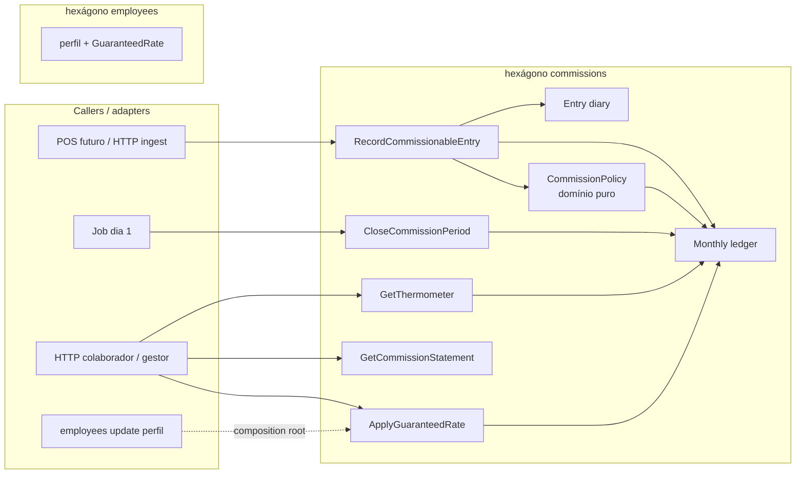
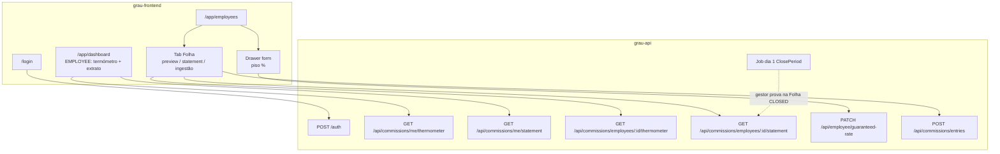

# Design Doc: Comissionamento por Colaboradores (v1)

**Status:** Draft — discussão nesta thread  
**Data:** 18/08/2026 · **Revisto:** 21/08/2026 (experiência ponta a ponta)  
**PRD:** [`prd-comissionamento-v1-1.md`](./prd-comissionamento-v1-1.md)  
**Constituição:** [`AGENTS.md`](../AGENTS.md) · hexágono de referência: [`employees/AGENT.md`](../src/modules/employees/AGENT.md)  
**Cliente:** [`grau-frontend`](../../grau-frontend) (Vue 3, mesmo conjunto de pastas)

Este documento fecha a **forma do módulo** (fronteiras, seams, fonte de verdade) **e** a **experiência ponta a ponta** das quatro user stories do PRD no `grau-frontend`. Specs de implementação por use case vêm depois, em `docs/specs/`.

---

## 1. Problema

O PRD já define **o que** calcular. Falta **onde** isso vive na API, **como** entra sem módulos de Produtos/Serviços, e **onde o utilizador vê** o resultado no `grau-frontend`:

1. Ingerir factos de venda/estorno por contrato.
2. Acumular faturamento bruto de **serviços** por colaborador × mês civil.
3. Aplicar taxa **absoluta** (não marginal) da faixa atingida, com piso opcional.
4. Produtos a 10% fixos, **fora** do acumulador.
5. Termómetro live + extrato + fecho automático no dia 1.
6. Fechar as 4 user stories nos ecrãs que já existem (Dashboard, form/detalhe de colaborador, tab Folha).

A complexidade (faixas, piso, timezone, estorno, arredondamento) fica **atrás de um hexágono fundo**. Nem o POS futuro nem o Vue reimplementam a tabela.

---

## 2. Objectivos e não-objectivos

### Objectivos v1

- Hexágono `commissions` independente, alinhado a Ports & Adapters.
- Desenvolvimento paralelo: ingestão por port, sem esperar Produtos/Serviços.
- Mesmo motor para preview (termómetro) e fecho (extrato congelado).
- Dinheiro sem `float`. Display EUR com 2 casas e arredondamento bancário (half-even).
- Idempotência na ingestão (o PRD não pede; o design exige).
- **Provar as 4 user stories no `grau-frontend`**, reusando ecrãs que já existem (Dashboard, Colaboradores, drawer, tab Folha).

### Não-objectivos v1

- Event sourcing / message bus / recálculo de política versionada.
- Folha agregada do gestor (tabela com N colaboradores num mês) — query futura, sem segundo motor. A **Folha por colaborador** (tab que já existe no drawer) **está** no v1.
- Payroll lock, pagamento, recibo PDF, transferência bancária.
- Módulo de Produtos/Serviços / POS de loja (a ingestão temporária no drawer prova o contrato).
- Expandir o cadastro de colaborador com os campos só-UI do form actual (género, morada, competências, …).
- Cupões/descontos — o caller envia o valor **já pago**.
- Restatement de mês fechado (estorno não reabre julho).

---

## 3. Linguagem (proposta)

Usar estes termos. Os outros ficam de lado.

**CommissionableEntry:** facto de venda ou estorno que pode gerar comissão (`SERVICE` | `PRODUCT`).  
_Avoid:_ transaction, ticket, sale line (conceitos do POS, não deste contexto).

**ServiceGross:** acumulador mensal **só** de serviços, com sinal.  
_Avoid:_ faturamento, revenue, GMV (ambíguos — incluem produto).

**ProductGross:** acumulador mensal só de produtos.

**CommissionPeriod:** mês civil em `Europe/Lisbon` (`year` + `month` 1..12).  
_Avoid:_ billing cycle, rolling 30 days.

**CommissionRate:** percentagem aplicada a serviços neste período (`max(tier, piso)`).  
_Avoid:_ percentage, fee.

**GuaranteedRate:** piso configurado no perfil do colaborador (direito adquirido).  
_Avoid:_ base rate override, floor (no código PT/EN misturado).

**CommissionStatement:** snapshot imutável de um período `CLOSED`.  
_Avoid:_ payslip, payroll, invoice.

**Thermometer:** vista live do período `OPEN` — `ServiceGross`, faixa actual, gap até à próxima.  
_Avoid:_ dashboard, progress, KPI.

**Ledger:** documento materializado `(employeeId, period)` com totais e taxas. Fonte de verdade **operacional**.

---

## 4. Três formas consideradas

Antes de fechar, o motor foi desenhado três vezes (constraint diferente em cada). Resumo; o detalhe fica nos agentes desta thread.

### A — Fachada mínima (`submit` + `inspect`)

Dois inbound ports. Intents (`INGEST` | `SET_GUARANTEED_RATE` | `CLOSE_PERIOD`) num comando; termómetro vs extrato numa query discriminada. Ledger append-only de entradas. Piso **deste** hexágono, não de employees.

**Força:** caller não precisa de saber o estado do mês. Um motor para preview e fecho.  
**Custo:** union larga; POS *pode* fechar período se o port for injectado sem disciplina. Folha do gestor fica de fora.

### B — Event-first (factos + projeções)

Único write real = append de factos. Política versionada por `ItemType`. Recálculo append-only (`PeriodSuperseded`). `ItemType` aberto. Piso temporal com `effectiveFrom`. ~12 inbound ports.

**Força:** auditoria, replay, mudar a tabela no futuro sem mentir o passado.  
**Custo:** superfície grande para um salão. Event store + projeções é overkill enquanto o volume é baixo e a política v1 é estável. Viola YAGNI face ao PRD.

### C — Totais mensais materializados (caminho quente)

`record` incrementa o ledger do mês e **devolve** o termómetro. `getThermometer` é O(1). Fecho = freeze (`OPEN → CLOSED`), zero recálculo. Piso no perfil de **employees**, snapshot no ledger. Sem event store público.

**Força:** o caso mais frequente (POS + termómetro) é trivial e barato. Alinha com a coluna do PRD.  
**Custo:** sem diário, auditoria linha-a-linha e repair hatch ficam fracos. `record` a devolver leitura mistura um pouco CQRS.

### Comparação

| Critério | A | B | C |
|----------|---|---|---|
| Profundidade da interface | Alta (2 ports) | Média (muitos ports, cada um fundo) | Alta no hot path |
| Locality do cálculo | Alta | Alta (fold + política) | Alta (documento do mês) |
| Extensão futura (nova política) | Média | Alta | Baixa (constantes internas) |
| Adequação ao volume v1 | Alta | Excesso | Alta |
| Auditoria / idempotência | Forte (`sourceId`) | Forte (stream) | Média (chave sem diário) |
| Acoplamento a employees | Recusa a coluna do PRD | Recusa a coluna | Split: perfil + snapshot |

**Recomendação:** híbrido **C + pedaços de A**. Totais materializados como fonte operacional; **diário append-only de `CommissionableEntry`** só para idempotência e suporte (não é event store, não há replay público). Piso no perfil de employees (PRD) + snapshot no ledger (fecho autónomo). CQRS clássico do repo: `record` **não** devolve termómetro — o POS que quiser o termómetro chama a query.

Não adoptar B em v1. Gatilho para pagar esse débito: mudança real da tabela de faixas em produção, ou auditoria jurídica que exija reconstituição do mês a partir de factos.

---

## 5. Decisão de forma (v1)

```text
src/modules/commissions/          ← hexágono novo
employees.guaranteedCommissionRate ← campo opcional de perfil (dono da config)
```



### Regras duras

1. Outros módulos **não** importam `commissions/domain`. Recebem ports no `app.ts`.
2. `commissions` **não** importa `employees/domain`. Lê o perfil via `EmployeeCommissionProfilePort`.
3. O motor de faixas é um **domain service puro** (`CommissionPolicy`). Sem I/O. Specs A–D do PRD vivem aqui **e** no seam do ledger.
4. Queries não passam por `Employee.create`, policies de employees, nem encrypter.
5. `Money` / `Eur` começa **local** a `commissions/domain`. Promover a `@shared/domain` só quando um segundo hexágono precisar ([create-value-object.md](./specs/create-value-object.md)).

---

## 6. Modelo de domínio

### 6.1 `CommissionPolicy` (puro)

Entrada: `ServiceGross`, `GuaranteedRate | null`.  
Saída: `{ tierRate, appliedRate, nextTier }`.

Tabela (limites: inferior inclusivo, superior exclusivo):

| Faixa | ServiceGross (EUR) | Taxa |
|-------|--------------------|------|
| T1 | `[0, 3500)` | 45% |
| T2 | `[3500, 4000)` | 50% |
| T3 | `[4000, 4500)` | 52% |
| T4 | `[4500, 5000)` | 54% |
| T5 | `[5000, 5500)` | 56% |
| T6 | `[5500, 6000)` | 58% |
| T7 | `[6000, ∞)` | 60% |

`appliedRate = max(tierRate, guaranteedRate ?? 0)`.  
Produto: constante interna `10%`. Fora desta tabela.  
Cálculo absoluto: `serviceCommission = ServiceGross × appliedRate` sobre **todo** o bruto do período.

`nextTier.remainingGross` é derivado da tabela, **não** hardcoded `+2%`.

### 6.2 Agregado operacional: `MonthlyCommission` (ledger)

Identidade: `(employeeId, CommissionPeriod)`.

| Campo | Notas |
|-------|--------|
| `status` | `OPEN` \| `CLOSED` |
| `serviceGross` | signed cents |
| `productGross` | signed cents |
| `guaranteedRateSnapshot` | copiado do perfil na abertura / no `ApplyGuaranteedRate` |
| `tierRate` / `appliedRate` | materializados após cada movimento |
| `serviceCommission` / `productCommission` | materializados (fecho não recalcula) |
| `closedAt` | preenchido no fecho |

Invariantes:

- Produto nunca incrementa `serviceGross`.
- Período `CLOSED` é imutável (venda com `occurredAt` nesse mês → erro).
- Estorno **não** escolhe o período: cai no `OPEN` corrente (PRD).
- `ServiceGross` / `ProductGross` não descem abaixo de zero em v1 (estorno excessivo → erro de domínio). Confirmar clawback negativo com produto — ver §13.

### 6.3 Diário: `CommissionableEntry`

Append-only, **não** é a fonte dos totais.

Campos mínimos: `idempotencyKey`, `employeeId`, `itemType`, `kind` (`SALE` | `REVERSAL`), `grossValue` (> 0; o sinal vem de `kind`), `occurredAt`, `appliedPeriod`, `recordedAt`.

Uso: retry do POS, suporte, reconciliação. Rebuild interno (repair hatch) pode reler o diário; **não** há `Recalculate` HTTP em v1.

### 6.4 Dinheiro

- Interno: inteiro em **cêntimos** (EUR).
- Borda HTTP/JSON: string decimal com 2 casas (`"3500.00"`). Nunca `number`.
- HALF_EVEN só no valor de **comissão** persistido no ledger (para o fecho ser um freeze).
- Taxas: percentagem inteira 0–100 nas faixas do PRD; piso igual.

---

## 7. Seams (ports)

### Inbound (v1)

```ts
RecordCommissionableEntryPort.execute(entry): Promise<{ entryId, period, duplicate }>
ApplyGuaranteedRatePort.execute({ employeeId, rate | null }): Promise<void>
CloseCommissionPeriodPort.execute(period): Promise<{ closedCount }>
GetThermometerPort.execute({ employeeId, period? }): Promise<Thermometer>
GetCommissionStatementPort.execute({ employeeId, period }): Promise<CommissionStatement>
```

Cinco ports, um por use case/query — padrão do repo. Não um God Service. Não doze ports de política versionada.

### Outbound

```ts
CommissionLedgerPort        // get / upsert do documento mensal (Mongo | memory)
CommissionEntryDiaryPort    // append + lookup por idempotencyKey
EmployeeCommissionProfilePort  // { id, commissionable, guaranteedRate } | null
ClockPort                   // now(); produção vs freeze em teste
```

`EmployeeCommissionProfilePort` é seam **real**: adapter de produção lê a collection `Employee` no infrastructure de commissions (mesmo padrão do `EmployeeAuthenticatableAdapter` em auth — **sem** importar entity `Employee`). Adapter de teste: in-memory.

Relógio e timezone (`Europe/Lisbon`) são contrato: “dia 1” e “mês da venda” são ambíguos em UTC.

---

## 8. Experiência ponta a ponta (`grau-frontend`)

O PRD só vale se um gestor e um colaborador conseguirem **ver** o resultado no ecrã. O backend sozinho não prova as user stories 2–4.

Estado actual do cliente (21/08/2026), no mesmo conjunto de pastas:

| Peça | Onde | Estado | Papel no v1 |
|------|------|--------|-------------|
| Login | `/login` | Feito (`token` only) | Precisa de sessão com `id`, `name`, `role` |
| Shell | `AppContainer` | Header hardcoded «Grau usuário / Administrador» | Passa a ler a sessão |
| Dashboard | `/app/dashboard` | Placeholder (`<h1>Dashboard</h1>`) | **Painel do colaborador**: termómetro + extrato |
| Colaboradores | `/app/employees` | Lista API + drawers | **Painel do gestor**: piso + Folha |
| Form criar/editar | `EmployeeFormPanel` | Muitos campos só-UI; create **não** chama a API | Nova secção «Comissionamento» (piso) |
| Detalhe | `EmployeeDetailPanel` | Tabs `Detalhes` / `Folha` | Folha deixa de ser stub |
| Tab Folha | idem | «Folha de pagamento em breve.» | Extrato + termómetro daquele colaborador + ingestão temporária |
| Nav | `Gestão` | Dashboard, Clientes (rota inexistente), Colaboradores | Sem item novo; Dashboard e Folha chegam |
| `StatCard` | componente | Usado na lista de colaboradores | Reusar no Dashboard / Folha |
| POS / vendas | — | Não existe | Ingestão temporária no drawer (mesmo port) |

Roles da API (`ADMIN` \| `MANAGER` \| `EMPLOYEE`) já vêm no JWT; o login **não** as devolve ao cliente. Sem isso o header, o `/me` e o filtro de nav não funcionam.

### 8.1 Actores no produto

| Actor (PRD) | Role API | O que vê | O que não vê |
|-------------|----------|----------|----------------|
| **Gestor** | `ADMIN`, `MANAGER` | Colaboradores, form (piso), tab Folha de **qualquer** colaborador, ingestão temporária | Termómetro «meu» como peça principal (pode existir no Dashboard, mas a prova da US2/US1 é a Folha) |
| **Colaborador** | `EMPLOYEE` | Dashboard (termómetro + extrato **próprio**), nav reduzida | Lista de colaboradores, form de piso, ingestão, Folha de outros |
| **Sistema** | job | — | Sem UI. O gestor **prova** o fecho abrindo a Folha do mês anterior a `CLOSED` |

Nav v1: `EMPLOYEE` só vê Dashboard (e eventualmente «As minhas comissões» se o Dashboard ficar carregado). `ADMIN`/`MANAGER` vê Gestão completa. Clientes continua fora deste doc.

### 8.2 Jornada G — Gestor configura o piso (US2)

```text
Login (MANAGER)
  → /app/employees
  → abre detalhe do colaborador (drawer que já existe)
  → Editar
  → secção «Comissionamento»
       campo opcional «Piso de comissão (%)»
       vazio = sem piso; 0–100 senão
       hint: «Garante uma taxa mínima de serviços. A faixa do mês prevalece se for maior.»
  → Guardar
  → PATCH piso (employees) + ApplyGuaranteedRate (commissions)
  → tab Detalhes mostra o piso (ou «Sem piso»)
  → tab Folha: se o mês OPEN já tiver ServiceGross, appliedRate actualiza já (FL-1)
```

O piso **não** é um ecrã novo. Vive no form e no detalhe, ao lado de cargo/status — o PRD pede o campo no perfil.

Campos só-UI do form actual (género, morada, competências, …) **não** entram neste fluxo. O save do piso é um comando estreito, não um «update employee» genérico.

### 8.3 Jornada C1 — Colaborador vê o termómetro (US3)

```text
Login (EMPLOYEE)
  → /app/dashboard  («o meu painel» do PRD)
  → widget Termómetro do CommissionPeriod OPEN (Europe/Lisbon)
```

Conteúdo do widget (o motor já calcula; o UI **não** reimplementa faixas):

| Elemento | Fonte | Copy (pt-PT) |
|----------|--------|----------------|
| Mês | `period` | «Agosto 2026» |
| Bruto de serviços | `serviceGross` | «Faturado em serviços» |
| Taxa em vigor | `appliedRate` | «A tua taxa agora» |
| Faixa da tabela | `tierRate` | visível se diferente do piso |
| Piso a ganhar | `guaranteedRate` vs `tierRate` | «Piso de 50% a prevalecer» (só se piso > faixa) |
| Gap | `nextTier.remainingGross` | «Faltam € 500,00 para 50% (+5 pp)» — o delta vem da API, **não** hardcoded +2% |
| Teto | `nextTier = null` | «Chegaste ao teto (60%)» |
| Preview | `serviceCommission` live | «Se o mês fechasse agora» — deixa claro o efeito retroactivo |

Barra de progresso: posição de `serviceGross` **dentro da faixa actual** (min da faixa → min da próxima). Não é 0–6000 numa barra só — isso esconde o incentivo da próxima +N pp.

`StatCard` existente serve os totais; a barra é um componente novo (`CommissionThermometer`). Zero lógica de tabela no frontend: se a API mudar T2 de 3500 para 3600, o ecrã segue.

Refresh: ao montar o Dashboard (`useQuery`). Sem polling. Depois de uma venda (ingest temporário noutro browser/role), o colaborador recarrega ou volta ao Dashboard.

### 8.4 Jornada C2 — Colaborador vê o extrato (US4)

No **mesmo** Dashboard, abaixo do termómetro:

| Bloco | Mostra |
|-------|--------|
| Serviços | `serviceGross`, `appliedRate`, `serviceCommission` |
| Produtos | `productGross`, `10%`, `productCommission` |
| Total | soma (o que «compõe o pagamento») |
| Selector de mês | OPEN = preview live; CLOSED = `CommissionStatement` congelado |

Se o mês seleccionado ainda não tem ledger: empty state «Ainda não há movimentos neste mês» — não inventar zeros a fingir fecho.

O colaborador **não** usa o drawer de Colaboradores para ver isto. A tab Folha é a vista do **gestor sobre outra pessoa**.

### 8.5 Jornada G2 — Gestor vê a Folha de um colaborador (prova US1 + US4)

A tab `Folha` deixa o stub e passa a ser:

1. Selector de `CommissionPeriod` (mês civil).
2. Se `OPEN`: o mesmo termómetro + o mesmo extrato preview, mas de `GET /api/commissions/employees/:id/…`.
3. Se `CLOSED`: banner «Apurado em {closedAt}» + extrato imutável. Sem ingestão. Sem editar piso com efeito neste mês.
4. Empty: «Sem actividade neste mês» (CL-4).

**Como o gestor prova o fecho automático (US1):** no dia 1 (ou num teste com relógio congelado), abre a Folha do mês anterior e vê `CLOSED` + os mesmos montantes que o preview de 31 do mês. Não há botão «Apurar». Não há ecrã de folha da loja inteira.

### 8.6 Jornada I — Ingestão temporária (contrato do PRD, até existir POS)

Sem isto o termómetro e o extrato nunca saem de zero no ecrã. Não é user story de produto; é o **adapter visível** do contrato §3 do PRD.

Sítio: tab Folha, só `OPEN`, só gestor. Bloco claramente marcado «Até existir caixa / POS».

| Campo | Notas |
|-------|--------|
| Tipo | `SERVICE` \| `PRODUCT` |
| Movimento | `SALE` \| `REVERSAL` |
| Valor bruto (€) | já com desconto; string 2 casas |
| Data/hora | default `now`; define o mês da **venda**; estorno ignora o mês e cai no OPEN |

O cliente gera `idempotencyKey` (`ui:{employeeId}:{uuid}`). Retry do botão não duplica.

Depois do `POST /api/commissions/entries` a Folha **refetch** imediatamente — o gestor vê o termómetro a subir/descer (incluindo queda de faixa no estorno).

Quando o POS existir: este bloco some; o POS chama o mesmo port. Zero mudança no Dashboard do colaborador.

### 8.7 Mapa ecrã → história → API



### 8.8 Sessão e o que o cliente precisa do login

Hoje: `{ token }`. JWT já contém `id`, `name`, `email`, `role`, `status`.

v1: o login **devolve também** a sessão (o cliente não precisa de `jwt-decode`):

```ts
interface LoginSessionDto {
  token: string;
  employeeId: string;
  name: string;
  role: 'ADMIN' | 'MANAGER' | 'EMPLOYEE';
}
```

O `auth` store deixa de persistir só o token. O header do `AppContainer` usa `name` + label da role. `/me/*` usa `employeeId` só como fallback visual — a API resolve o id pelo token, não pela query string (um colaborador não lê o termómetro de outro mudando a URL).

Authz HTTP: débito conhecido do repo (token = acesso). Para o E2E **não mentir**:

- `/me/*` → sempre o `sub` do token.
- `/employees/:id/*` e `POST /entries` e `PATCH guaranteed-rate` → em v1 documentar como «gestor»; filtrar na presentation quando o middleware de role existir. Até lá, o **nav do frontend** esconde estes caminhos ao `EMPLOYEE`.

### 8.9 Copy e formatação (contrato de UI)

- Locale `pt-PT`, currency `EUR`, 2 casas. O backend já envia string `"1750.00"`; o cliente formata com `Intl.NumberFormat` para `€ 1.750,00`. **Não** voltar a calcular percentagens.
- Não mostrar a tabela T1–T7 completa no Dashboard (é ruído). Mostrar só faixa actual + próxima. A tabela pode viver num tooltip «Como funciona» no widget.
- Piso: percentagem inteira. Placeholder «Sem piso». Não oferecer só os valores da tabela (47% é válido — §13.5).

### 8.10 Gaps do frontend que este fluxo **não** resolve

| Gap | Relação com comissionamento |
|-----|-----------------------------|
| Create/edit colaborador ainda não persiste na API | O piso precisa de um PATCH **estreito**; não desbloqueia o form inteiro |
| Tab Folha / Dashboard vazios | Este doc preenche |
| Rota `/app/clients` na nav sem vista | Fora |
| Permissões do form (Manager/Operador/…) ≠ roles da API | Usar `ADMIN` / `MANAGER` / `EMPLOYEE` no piso e na nav; não misturar |

---

## 9. HTTP, job e contratos de ecrã

Auth: `authTokenMiddleware`. Role-based authz no servidor continua débito; o cliente esconde rotas por `role` da sessão.

| Método | Path | Actor / ecrã | Port |
|--------|------|----------------|------|
| `POST` | `/auth` | Login | sessão com `employeeId`, `name`, `role` |
| `GET` | `/api/commissions/me/thermometer` | Dashboard colaborador | `GetThermometer` (id do token) |
| `GET` | `/api/commissions/me/statement?year=&month=` | Dashboard colaborador | `GetCommissionStatement` |
| `GET` | `/api/commissions/employees/:id/thermometer` | Tab Folha (gestor) | `GetThermometer` |
| `GET` | `/api/commissions/employees/:id/statement?year=&month=` | Tab Folha (gestor) | `GetCommissionStatement` |
| `POST` | `/api/commissions/entries` | Tab Folha — ingestão temporária | `Record…` |
| `PATCH` | `/api/employee/guaranteed-rate` | Form colaborador | employees + `ApplyGuaranteedRate` |
| — | job 00:05 `Europe/Lisbon` no dia 1 | sem UI | `CloseCommissionPeriod(mês anterior)` |

Shapes de leitura (borda JSON; dinheiro em string 2 casas):

```ts
interface ThermometerDto {
  employeeId: string;
  period: { year: number; month: number };
  status: 'OPEN' | 'CLOSED';
  serviceGross: string;
  productGross: string;
  tierRate: number;
  guaranteedRate: number | null;
  appliedRate: number;
  nextTier: {
    rate: number;
    remainingGross: string;
    rateDelta: number; // pp até à próxima, ex. 5
  } | null;
  preview: {
    serviceCommission: string;
    productCommission: string;
    total: string;
  };
}

interface CommissionStatementDto {
  employeeId: string;
  period: { year: number; month: number };
  status: 'OPEN' | 'CLOSED';
  closedAt: string | null;
  products: { gross: string; rate: number; commission: string };
  services: { gross: string; rate: number; commission: string };
  totalCommission: string;
}
```

`GET statement` de um período `OPEN` devolve o mesmo shape com `closedAt: null` (preview). O UI trata `CLOSED` como só de leitura.

Ingestão HTTP é **adapter temporário**. Quando o POS existir, injeta o mesmo `RecordCommissionableEntryPort`.

`close` **não** tem botão. Fechar o mês corrente partiria a ingestão do dia. Job só fecha o **anterior**.

---

## 10. Cruzamento com employees e com o frontend

| Dado | Dono | Como cruza |
|------|------|------------|
| Identidade, status, role | `employees` | directory port (read) |
| `guaranteedCommissionRate` | `employees` (perfil) | persistido no schema de employee; após write, `app.ts` chama `ApplyGuaranteedRate` |
| Taxa **em vigor no mês** | `commissions` (snapshot no ledger) | OPEN actualiza; CLOSED não mexe |
| Faixas, 10% produto, termómetro | `commissions` | employees não conhece |

Isto honra o PRD (“coluna no perfil”) **e** a regra de hexágono (employees não calcula comissão).

Comando HTTP estreito — o form do frontend **não** espera um update genérico do colaborador:

```ts
interface UpdateEmployeeGuaranteedRateDto {
  id: string;
  guaranteedCommissionRate: number | null; // null remove o piso
}
```

`PATCH /api/employee/guaranteed-rate` persiste no schema de employee e, no composition root, chama `ApplyGuaranteedRate`. List/get de employees passam a incluir o campo no read model (o drawer de detalhe mostra-o sem ir a commissions).

`INACTIVE`: recusa nova `SALE`; estorno e fecho do que já acumulou no mês **ainda pagam**.  
`VACATION`: continua a comissionar (proposta — confirmar em §13).

O `grau-frontend` hoje lista colaboradores via API mas o create/edit do drawer **não** persiste. Este fluxo não desbloqueia o cadastro completo: só o piso e a sessão de login.

---

## 11. Cenários de implementação (aceitação)

Estes cenários são a superfície de teste do hexágono. Specs de use case/query devem citá-los, não reinventar a tabela.

### Núcleo do PRD (A–D)

| ID | Setup | Esperado |
|----|--------|----------|
| A | Serviço € 3.500, sem piso | T2 50% → comissão serviço **€ 1.750,00** |
| B | Serviço € 5.000, sem piso | T5 56% → **€ 2.800,00** |
| C | Piso 50%, serviço € 2.000 | T1 45% perde para piso → **€ 1.000,00** |
| D | Piso 50%, serviço € 4.500 | T4 54% > piso → **€ 2.430,00** |

Limites de faixa (não estão nos exemplos do PRD; o motor tem de os cravar):

| ID | ServiceGross | Faixa |
|----|--------------|--------|
| T1-max | € 3.499,99 | T1 45% |
| T2-min | € 3.500,00 | T2 50% |
| T7-min | € 6.000,00 | T7 60% |

### Misto produto × serviço

| ID | Factos | Esperado |
|----|--------|----------|
| MIX-1 | Serviço € 3.000 + produto € 100 | `ServiceGross` = 3000 (T1 45%); produto 10% = € 10; produto **não** empurra para T2 |
| MIX-2 | Só produto € 200 | Termómetro de serviços a zeros; extrato produtos € 20 |

### Termómetro live

| ID | Estado | Esperado |
|----|--------|----------|
| TH-1 | Serviço € 3.000, sem piso | `remainingGross` = € 500,00 para T2 50% |
| TH-2 | Serviço € 6.000 | `nextTier = null` (teto) |
| TH-3 | Após A, mais € 1,00 de serviço | Faixa sobe neste `record`; termómetro reflecte já a taxa absoluta sobre o **total** |

O termómetro mostra a taxa **como se o mês fechasse agora** (absoluta). Mostrar taxa marginal mentiria o pagamento.

### Estornos

| ID | Sequência | Esperado |
|----|-----------|----------|
| REV-1 | Serviço € 4.000 (T3 52%), estorno € 600 **no mesmo mês** | `ServiceGross` € 3.400 → T1 45% |
| REV-2 | Julho fechado com T5; estorno em Agosto da venda de Julho | Statement de Julho **intacto**; Agosto abate `ServiceGross` (pode ficar baixo / erro se não houver bruto em Agosto — §13) |
| REV-3 | Retry do mesmo estorno (`idempotencyKey` igual) | `duplicate: true`, totais iguais |
| REV-4 | Estorno de serviço maior que o `ServiceGross` OPEN | `InsufficientGrossError` (v1) |

### Fecho

| ID | Sequência | Esperado |
|----|-----------|----------|
| CL-1 | 1 Ago 00:05 Lisbon → `close({ year: 2026, month: 7 })` | Ledgers de Julho `CLOSED`; termómetro de Agosto `OPEN` |
| CL-2 | `close` duas vezes | Segunda: `closedCount = 0`, sucesso (job pode repetir) |
| CL-3 | Venda com `occurredAt` em Julho **depois** do fecho | `CommissionPeriodClosedError` |
| CL-4 | Colaborador sem actividade em Julho | Sem statement a zeros (não materializa linha) |
| CL-5 | Preview do termómetro em 31 Jul = statement após CL-1 | Montantes iguais (um motor) |

### Piso a meio do mês

| ID | Sequência | Esperado |
|----|-----------|----------|
| FL-1 | Serviço € 2.000 (T1), depois piso 50% no dia 15 | OPEN recalcula: `appliedRate` 50% sobre os € 2.000 **já** acumulados |
| FL-2 | Mês CLOSED, gestor altera piso no perfil | Statement fechado **não** muda; próximo OPEN usa o novo piso na abertura |
| FL-3 | `ApplyGuaranteedRate` sem ledger ainda | No-op no ledger; próxima abertura copia o perfil |

### Identidade e estado do colaborador

| ID | Caso | Esperado |
|----|------|----------|
| EMP-1 | `employeeId` inexistente na ingestão | `EmployeeNotCommissionableError` |
| EMP-2 | `INACTIVE` a meio do OPEN | Novas vendas recusadas; fecho paga o snapshot |
| EMP-3 | Dois colaboradores, mesmos totais | Faixas independentes |

### Precisão

| ID | Caso | Esperado |
|----|------|----------|
| MON-1 | Qualquer `number` IEEE na borda | Rejeitado; só string decimal |
| MON-2 | Comissão com fracção de cêntimo | HALF_EVEN para 2 casas no campo de comissão do ledger |
| MON-3 | Gross já vem com desconto | Módulo não aplica cupão |

### Idempotência e concorrência

| ID | Caso | Esperado |
|----|------|----------|
| ID-1 | Mesma `idempotencyKey` + mesmo payload | Não soma outra vez |
| ID-2 | Mesma chave + payload diferente | `IdempotencyConflictError` |
| ID-3 | Duas vendas simultâneas do mesmo colaborador | Sem lost update no `ServiceGross` (lock / update atómico no ledger) |

### Experiência no `grau-frontend` (prova das user stories)

Estes cenários são a superfície de teste **do cliente**. Falham se a API estiver certa mas o ecrã mentir (recalcular faixa, formatar `number`, mostrar Folha stub).

| ID | Actor / ecrã | Sequência | Esperado |
|----|----------------|-----------|----------|
| UX-G1 | Gestor / form | Abrir colaborador sem piso → gravar 50% | Detalhe mostra «Piso 50%»; Folha OPEN com cenário C passa a `appliedRate` 50 |
| UX-G2 | Gestor / form | Limpar o piso | Detalhe «Sem piso»; Folha volta à faixa da tabela |
| UX-G3 | Gestor / Folha | Selector mês anterior `CLOSED` | Banner «Apurado em …»; sem bloco de ingestão; montantes iguais ao preview pré-fecho (CL-5) |
| UX-I1 | Gestor / Folha OPEN | Registar serviço € 3.000 | Termómetro da Folha: gap € 500 para 50%; Dashboard do colaborador (outro login) igual após refresh |
| UX-I2 | Gestor / Folha OPEN | MIX-1 (serviço + produto) | Extrato: serviços 45% / produtos 10%; barra **não** usa o produto |
| UX-I3 | Gestor / Folha OPEN | REV-1 | Faixa desce no termómetro no mesmo refetch |
| UX-C1 | Colaborador / Dashboard | TH-1 | Copy «Faltam € 500,00 para 50%»; **não** aparece a tabela T1–T7 completa |
| UX-C2 | Colaborador / Dashboard | Cenário C | Badge «Piso de 50% a prevalecer»; total preview € 1.000,00 |
| UX-C3 | Colaborador / Dashboard | Selector mês `CLOSED` | Extrato produtos vs serviços; termómetro de gap escondido (mês morto) |
| UX-C4 | Colaborador / nav | Login `EMPLOYEE` | Não vê Colaboradores; `/me` nunca aceita `employeeId` de outrem na query |
| UX-S1 | Header | Login `Maria` `MANAGER` | Deixa de mostrar o hardcoded «Grau usuário / Administrador» |
| UX-E1 | Folha / empty | Colaborador sem movimentos no mês | «Ainda não há movimentos neste mês» — não mostra € 0,00 a fingir apuro |

---

## 12. Partes de entrega (playbook)

API: seguir [`AGENTS.md`](../AGENTS.md) (command/query → controller → route → repo → `*.module.ts` → `AGENT.md` do módulo). Specs por parte em `docs/specs/commissioning/`.  
Frontend: `grau-frontend` — composables + `services/api` no mesmo padrão de `http-employees-api` / Vue Query.

O E2E só está «provado» quando a coluna **Cliente** da parte está verde, não só a API.

| Parte | API | Cliente (`grau-frontend`) | Pronto quando |
|-------|-----|---------------------------|---------------|
| 0 | `Eur` + `CommissionPolicy` + A–D / limites | — | Motor puro verde |
| 1 | Diário + ledger + `Record…` + `POST /entries` | Tab Folha: bloco «Registar movimento» (gestor) | UX-I1, MIX, REV-1, ID-1 |
| 2 | `GetThermometer` `/me` e `/employees/:id` | Dashboard widget + Folha live | UX-C1, TH-1..3 |
| 3 | `guaranteedCommissionRate` + `PATCH …/guaranteed-rate` + `ApplyGuaranteedRate` | Secção piso no form + campo no detalhe | UX-G1/G2, C, D, FL-1 |
| 4 | `ClosePeriod` + job + `GetStatement` `/me` e `/employees/:id` | Extrato no Dashboard + Folha CLOSED | UX-C3, UX-G3, CL-1..5 |
| 5 | Login devolve sessão (`employeeId`, `name`, `role`) | Store + header + nav por role | UX-S1, UX-C4 |
| 6 | `src/client/commission.http` + `commissions/AGENT.md` | Empty states UX-E1; i18n `pt-PT` EUR | Contrato vivo nos dois repos |

Parte 0 antes de Mongo. Parte 5 pode avançar em paralelo (o JWT já tem as claims; falta o DTO de login e o store).  
Ingestão no UI (Parte 1) some quando o POS existir; o Dashboard não muda.

---

## 13. Decisões abertas

Precisam de confirmação de produto **antes** da Parte 1 fechar o contrato HTTP. O resto do doc assume a opção em **negrito**.

1. **Timezone do período** — **`Europe/Lisbon`**, mês civil (não rolling 30 dias). Venda 1 Ago 00:30 WEST é Agosto.
2. **Estorno sem bruto no mês OPEN** (REV-2 puro) — **recusar** (`InsufficientGrossError`) vs permitir comissão negativa (clawback). PRD fala em abater o mês actual; não fala em saldo negativo.
3. **`VACATION`** — **comissiona**; `INACTIVE` não recebe novas vendas.
4. **Piso a meio do mês** — **aplica-se ao bruto já acumulado** do OPEN (FL-1). Alternativa pró-rata exige outro modelo.
5. **Piso > 60% ou valor fora da tabela (ex. 47%)** — **permitir 0–100** no perfil; o motor faz `max`. Restringir à tabela seria regra de RH em employees.
6. **Janela no dia 1** — job às **00:05 Lisbon**; POS tem de ingestão síncrona. Sem grace period. Venda atrasada de Julho depois do fecho = 409, não “cai em Agosto”.
7. **Folha agregada (N colaboradores num ecrã)** — **fora do v1**. A tab Folha **por colaborador** (já no drawer) está no v1.
8. **Quem gera `idempotencyKey`** — POS: **`origin:reference`**. UI temporária: **`ui:{employeeId}:{uuid}`**.
9. **HALF_EVEN vs HALF_UP comercial** — **bancário**, como o PRD. Troca é locality (um sítio) mas é contrato.
10. **Authz no servidor** — token = acesso continua débito. **Nav do frontend esconde** ingestão/piso/Folha alheia ao `EMPLOYEE`. `/me` resolve sempre pelo token.
11. **Gestor no Dashboard** — **não** é o sítio da prova. Gestor prova US1/US2/US4 na lista + Folha. Dashboard v1 é o painel do colaborador; se um `MANAGER` abrir Dashboard, empty ou o *seu* termómetro (ele também pode ter serviços).
12. **Ingestão temporária visível** — **sim, na Folha OPEN**, marcada «Até existir caixa / POS». Sem isto o E2E não corre no ecrã.

---

## 14. O que este desenho recusa

- Lógica de faixas dentro de `employees` ou no controller.
- `float` / `number` JSON para dinheiro.
- Cálculo **progressivo** (marginal) das faixas.
- Produto no `ServiceGross`.
- Estorno que **reabre** um `CommissionStatement`.
- `Recalculate` / publish de política versionada em v1.
- Enum de loja/equipa (tiers são individuais; a interface não deixa fazer o errado).
- Reusar snapshot de persistência de employee como read model de comissão.
- Recalcular faixas ou 10% no `grau-frontend`.
- Ecrã novo de «Comissões» na nav (Dashboard + Folha chegam).
- Botão «Apurar mês» (a US1 é automática; a prova é a Folha `CLOSED`).
- Desbloquear o cadastro completo do colaborador só para gravar o piso.

---

## 15. Próximo passo

1. Fechar as decisões da §13 (mesmo que seja «aceitar os defaults em negrito»).
2. Abrir spec da Parte 0 (`CommissionPolicy` + `Eur`) em `docs/specs/commissioning/`.
3. Spec de ecrã da Parte 2/4 (Dashboard + Folha) no `grau-frontend` quando a API de leitura existir — não desenhar componentes à frente do contrato JSON da §9.
4. Só então código nos dois repos. O hexágono `commissions` ainda não existe.

Quando a Parte 1 estabilizar, criar `src/modules/commissions/AGENT.md` com o contrato corrente (não no dia zero), como manda a constituição.
