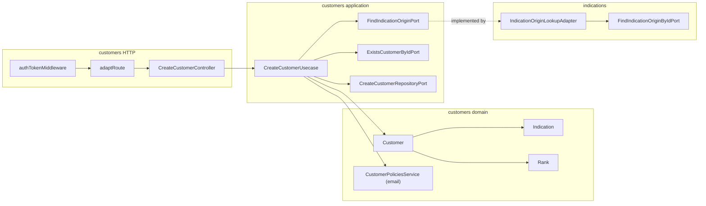

# Design Doc: Customer Rank and Indication on Create (v1)

**Status:** Draft, shape agreed in grilling session
**Date:** 15/10/2026
**PRD:** [`docs/prd/customer-ranking-indications-v1.md`](../prd/customer-ranking-indications-v1.md) (v1.0)
**Glossary:** [`src/modules/customers/CONTEXT.md`](../../src/modules/customers/CONTEXT.md) (Rank, Indication, Referrer) and [`src/modules/indications/CONTEXT.md`](../../src/modules/indications/CONTEXT.md) (Category, Origin, Channel, Campaign, Friend, Linkable origin)
**Reading copy:** [`customer-ranking-indications-v1.pt.md`](./customer-ranking-indications-v1.pt.md)
**ADRs:** [`docs/adr/customer-ranking-indications/`](../adr/customer-ranking-indications/)
**Constitution:** [`AGENTS.md`](../../AGENTS.md)

This document closes **where** the work lives in `grau-api`, **which seams** it crosses, and **how** HTTP looks for the frontend. It does not replace the PRD for product rules. The English file is the contract. The Portuguese file is a reading copy of the same decisions.

---

## 1. Problem

The PRD defines **what** must happen. Today `customers` does not:

1. Hold a rank. `Customer` has `name`, `email`, `phone`, `nif`, `createdAt`.
2. Hold an indication. There is no link to a Channel, Campaign, or Friend.
3. Refuse with a useful status. `CreateCustomerController` sends every error to `serverError` (`500`), including `CustomerAlreadyExistsError`.
4. Depend on `indications`. `CONTEXT-MAP.md` calls Customers "independent of this flow".
5. Offer an `EMPLOYEE` a way to choose an origin. The catalog read is `ADMIN` and `MANAGER` only.

Complexity sits in three places: the shape of the indication (all-or-nothing, two shapes), the seam to `indications` (hexagons do not import each other's domain), and the HTTP mapping of refusals.

---

## 2. Objectives and non-goals

### Objectives v1

- `Customer` holds a `rank` and an optional `indication`.
- A customer is **born `BRONZE`**. The rank is never input. No code path changes it.
- `Indication` is a value object owned by `customers` with two shapes: origin (`canal` or `campanha` + `originId`) and friend (`amigo` + `referrerCustomerId`). An incoherent one cannot be built.
- Create validates everything before writing. One `insert` of one document.
- `customers` consults `indications` through its own outbound port. An adapter in `indications` implements it.
- `indications` gains one read: linkable origins, for any authenticated employee.
- Refusals have a status: `400` for invalid data or indication, `409` for a taken email, `500` only for the unexpected.

### Non-goals v1

- Any transition of rank, and any endpoint that changes it.
- Listing or reading customers, filtering by rank, "Indicou N", a friend picker backed by the API.
- Changing or removing an indication after create.
- A migration or backfill (no customers are stored before this feature).
- A Mongo transaction ([ADR 0003](../adr/customer-ranking-indications/0003-no-transaction-on-create-customer.md)).
- An index on `indication.originId` or `indication.referrerCustomerId`. The reads that need them do not exist yet.
- Changing `requireRoles` on the catalog read or the catalog commands.

---

## 3. Language

Use the two glossaries. Do not invent parallel terms.

| Term | Where |
|------|-------|
| Customer, Rank, Born Bronze, Indication, Walk-in, Referrer | [`customers/CONTEXT.md`](../../src/modules/customers/CONTEXT.md) |
| Category, Origin, Channel, Campaign, Friend, End, Reopen, Linkable origin | [`indications/CONTEXT.md`](../../src/modules/indications/CONTEXT.md) |

`facts`, `kind`, and `ensureOriginIsLinkable` are implementation names, not glossary terms. "Absent" means the key is not in the body or its value is `null`. Any other value, including an empty string, counts as sent.

---

## 4. Forms considered

Closed in the grilling session. Product rules stay in the PRD. These are **shape** decisions.

### Who builds the bridge from customers to indications

| | A: adapter in `indications` | B: adapter in `customers` reads `origins` | C: adapter in `app.ts` or shared |
|--|-----------------------------|-------------------------------------------|----------------------------------|
| Owner of the "active" rule | `indications` | `customers` copies it | nobody |
| Import direction | `indications` imports a `customers` port | `customers` knows the origin schema | both import a shared file |
| Precedent | `auth` serves `employees` | none | none |

**Chosen: A** ([ADR 0001](../adr/customer-ranking-indications/0001-customers-consult-origins-through-a-port-implemented-by-indications.md)).

### What the port answers

| | A: facts | B: a decision |
|--|----------|---------------|
| Answer | `{ id, categoryId, active }` or `null` | may link / may not |
| Who applies "exists, same category, active" | `customers` | `indications` |
| Reason for refusal | known (unknown, wrong category, ended) | lost |

**Chosen: A.** "What a customer may link" is a customer rule.

### Who calls the port, who decides

| | A: use case loads, domain decides | B: domain service with the port in `domain/ports/` | C: policy in `application` |
|--|-----------------------------------|----------------------------------------------------|-----------------------------|
| Port location | `application/ports/outbound/` | `domain/ports/` | `application/ports/outbound/` |
| Rule location | pure method on `Indication` | domain service | application service |
| Rule 6 of `AGENTS.md` | respected | `indications` imports a `customers` domain file | respected |
| Rule 1 of `AGENTS.md` (domain pure) | respected | respected | rule leaves the domain |

**Chosen: A.** The use case calls the port and passes plain facts to `Indication`. The domain calls no port.

### How the indication is modeled

| | A: own value object | B: shared category codes in `@shared/domain` | C: loose fields, use case validates |
|--|---------------------|-----------------------------------------------|--------------------------------------|
| Incoherent combination | cannot be built | cannot be built | the entity accepts it |
| Category codes | copied in `customers` | one source | strings |
| Cost now | none | refactor of `indications` | rules outside the domain |

**Chosen: A** ([ADR 0002](../adr/customer-ranking-indications/0002-indication-is-an-embedded-value-object-owned-by-customers.md)).

### How it is stored

| | A: embedded, ObjectId | B: embedded, string ids | C: separate collection |
|--|-----------------------|-------------------------|------------------------|
| Writes on create | 1 | 1 | 2 |
| Native type for later joins | yes | no | yes |
| All or nothing | one document | one document | needs a transaction |

**Chosen: A.**

### Concurrency

**Chosen: no transaction** ([ADR 0003](../adr/customer-ranking-indications/0003-no-transaction-on-create-customer.md)). The email unique index is the backstop and its duplicate-key error becomes `CustomerAlreadyExistsError`.

### Where the indication shape is checked

| | A: controller presence, domain combinations | B: controller checks everything |
|--|---------------------------------------------|----------------------------------|
| Controller | `name`, `email`, and `categoryId` when `indication` is sent | all of it |
| Combination rules | `Indication.create` | the controller |
| A second entry point | gets the rules for free | repeats them |

**Chosen: A.**

### HTTP refusals

| Situation | Chosen |
|-----------|--------|
| Invalid name, email, phone, nif; invalid indication; unknown, wrong-category, or ended origin; unknown referrer | `400` |
| Email already used | `409` (today it is `500`) |
| Missing `name`, `email`, or `indication.categoryId` | `400` `MissingParamError` |
| Unexpected | `500` |
| No / invalid session | `401` (existing middleware) |

This API has no `404`. Unknown ids stay `400`, as in `indications` and `employees`.

### Response shape

`{ data: ... }` on every success, as the rest of the API. The PRD example `{ id }` and `{ origins }` was shorthand and has been corrected to match.

### Rank

Stored, born `BRONZE`, no transition ([ADR 0004](../adr/customer-ranking-indications/0004-rank-is-stored-and-born-bronze.md)).

### How a future read shows the origin or friend name

| | A: the query composes through ports | B: `ref` + `populate()` or `$lookup` | C: name stored at create |
|--|-------------------------------------|---------------------------------------|--------------------------|
| Where the join happens | `application/queries/` | the database or Mongoose | none |
| Foreign data comes from | the owner's port (batch of ids) | the foreign collection, read directly | a copy on the customer |
| Coupling to `indications` | a port | its model and schema | none |
| Origin name corrected later | read live | read live | stale |

**Chosen: A** ([ADR 0005](../adr/customer-ranking-indications/0005-cross-module-reads-are-composed-in-the-query-through-ports.md)). Not built in v1: this PRD has no customer read. It only fixes the standard, so the schema stores plain `ObjectId` ids with **no** `ref`. The query merges into a read-model DTO, not an entity. The referrer name comes from the customers' own read port.

---

## 5. Decision of form (v1)

```text
customers domain          → Rank (closed set, BRONZE | SILVER | GOLD)
                          → Indication (value object, two shapes)
                          → Customer (+ rank, + indication)
customers application     → CreateCustomerUsecase (+ origin and referrer checks)
                          → FindIndicationOriginPort (outbound, implemented by indications)
                          → ExistsCustomerByIdPort (outbound, implemented by the customer repository)
customers persistence     → rank + embedded indication, ObjectId ids
customers HTTP            → authTokenMiddleware → adaptRoute (unchanged gate)

indications application   → GetLinkableIndicationOriginsQuery (reuses ListIndicationOriginsPort)
indications outbound      → IndicationOriginLookupAdapter (implements FindIndicationOriginPort)
indications HTTP          → GET /api/indication-linkable-origins, authTokenMiddleware only
```



Do **not** import `@modules/indications/domain` from `customers`. Do **not** call a port from the domain. Do **not** forward `rank` from the body. Do **not** add a method that changes the rank.

---

## 6. As-is vs to-be

| Surface | Today | v1 |
|---------|-------|----|
| `Customer` fields | name, email, phone, nif, createdAt | + `rank`, + `indication` (optional) |
| Rank | none | `BRONZE` from birth |
| `POST /api/customer` body | name, email, phone?, nif? | + `indication?` |
| Refusal status | everything `500` | `400` / `409` / `500` |
| `app.ts` order | customers, then indications | indications, then customers |
| Linkable origins | none | `GET /api/indication-linkable-origins` |
| `CONTEXT-MAP.md` | Customers independent | Customers depends on Indications through a port |

---

## 7. Domain (customers)

### 7.1 `Rank`

A closed set, like `IndicationCategories`, in `domain/rank.ts`.

```ts
type Rank = 'BRONZE' | 'SILVER' | 'GOLD'
```

The ladder order is the array order. `INITIAL_RANK` is `'BRONZE'`. There is no promote method. A later PRD adds the transition.

### 7.2 `Indication`

A value object in `domain/value-objects/indication.vo.ts`. Two shapes, as a discriminated union:

```ts
type IndicationSnapshot =
  | { categoryId: 'canal' | 'campanha'; originId: string }
  | { categoryId: 'amigo'; referrerCustomerId: string }

type IndicationOriginFacts = { categoryId: string; active: boolean }   // domain/models/
```

`Indication.create(input: { categoryId; originId?; referrerCustomerId? })`:

1. `categoryId` must be one of the three codes, else `CustomerIndicationInvalidError`.
2. `canal` or `campanha`: `originId` is required and `referrerCustomerId` must be absent.
3. `amigo`: `referrerCustomerId` is required and `originId` must be absent.
4. A required id must be a string and a valid `UniqueEntityId` (24-character hex). A malformed id is refused with `InvalidUniqueEntityIdError`.
5. "Absent" is a missing key or `null`. Any other value, including `""`, counts as sent. An unrelated id sent as `""` is refused.

Pure rules on the instance, called by the use case with plain data:

```ts
ensureOriginIsLinkable(facts: IndicationOriginFacts | null): void
ensureReferrerExists(exists: boolean): void
```

| Error | When |
|-------|------|
| `CustomerIndicationOriginNotFoundError` | `facts` is `null` |
| `CustomerIndicationOriginCategoryMismatchError` | `facts.categoryId` differs from the indication's `categoryId` |
| `CustomerIndicationOriginEndedError` | `facts.active` is `false` |
| `CustomerReferrerNotFoundError` | `exists` is `false` |

`ensureOriginIsLinkable` on a friend shape, and `ensureReferrerExists` on an origin shape, are programming errors and throw a plain `Error`. The use case never calls them that way.

`Indication.reconstitute(snapshot)` rebuilds from persistence without re-validating against the catalog. `toJSON()` returns the snapshot.

### 7.3 `Customer`

```ts
Customer.create({ name, email, phone?, nif?, indication? })
  // rank = INITIAL_RANK ('BRONZE'); indication = Indication.create(...) or null
Customer.reconstitute({ id, name, email, phone, nif, createdAt, rank, indication })
```

`create` takes no `rank`. `reconstitute` takes it, so the three ranks can be held. `toJSON()` serializes `indication` through the value object, and `null` when absent.

### 7.4 Errors

| Error | HTTP | When |
|-------|------|------|
| `InvalidNameError`, `InvalidEmailError`, `InvalidPhoneFormatError`, `InvalidNifError` (shared) | `400` | VO validation |
| `InvalidUniqueEntityIdError` (shared) | `400` | Malformed `originId` or `referrerCustomerId` |
| `CustomerIndicationInvalidError` | `400` | Unknown category, missing id, both ids, the id of the other shape, indication that is not an object |
| `CustomerIndicationOriginNotFoundError` | `400` | Origin id does not exist |
| `CustomerIndicationOriginCategoryMismatchError` | `400` | Origin belongs to another category |
| `CustomerIndicationOriginEndedError` | `400` | Origin is ended |
| `CustomerReferrerNotFoundError` | `400` | Referrer id does not exist |
| `CustomerAlreadyExistsError` | `409` | Email taken, or duplicate key `11000` on the email index |

---

## 8. Application (customers)

### 8.1 DTOs

```ts
interface CreateCustomerIndicationDto {
  categoryId: string
  originId?: string | null
  referrerCustomerId?: string | null
}

interface CreateCustomerDto {
  name: string
  email: string
  phone?: string | null
  nif?: number | null
  indication?: CreateCustomerIndicationDto | null
}

interface CreateCustomerResultDto { id: string }
```

### 8.2 Outbound ports (one method each, `application/ports/outbound/`)

```ts
interface FindIndicationOriginPort {
  findOrigin(id: string): Promise<IndicationOriginFacts | null>
}

interface ExistsCustomerByIdPort {
  existsById(id: string): Promise<boolean>
}
```

`CreateCustomerRepositoryPort` and `FindCustomerByEmailPort` stay. The customer repository implements `ExistsCustomerByIdPort`. `indications` implements `FindIndicationOriginPort`.

### 8.3 Create flow

1. `Customer.create({ name, email, phone, nif, indication })`. VO errors, the indication shape, and `rank = BRONZE` happen here. Then `.toJSON()` for the snapshot.
2. `ensureEmailIsAvailable(email)`.
3. Origin shape: `findOrigin(originId)` then `indication.ensureOriginIsLinkable(facts)`. Friend shape: `existsById(referrerCustomerId)` then `indication.ensureReferrerExists(exists)`. No indication: skip.
4. `create(snapshot)`. A duplicate key on the email index becomes `CustomerAlreadyExistsError`.
5. Return `{ id }`.

Nothing is written before step 4. An invalid indication never creates the customer without a link.

---

## 9. Linkable origins (indications)

A new query in `application/queries/`.

```ts
GetLinkableIndicationOriginsResultDto {
  origins: { id: string; categoryId: 'canal' | 'campanha'; name: string }[]
}
```

`GetLinkableIndicationOriginsQuery` reuses `ListIndicationOriginsPort`. No new outbound port and no repository change. It keeps rows with `active === true`, orders Canal first then Campanha, and inside a category by `position` then `id` (`compareByPositionThenId`). It exposes `id`, `categoryId`, `name` only. No active origin gives `origins: []`. It does not read `IndicationCategories.holdsOrigins`: only `canal` and `campanha` rows exist.

### 9.1 `IndicationOriginLookupAdapter`

In `indications/infrastructure/outbound/`. Implements `FindIndicationOriginPort` (a `customers` port). It calls `FindIndicationOriginByIdPort`, rebuilds the entity with `IndicationOriginSnapshotMapper.toEntity`, and returns `{ id, categoryId, active }` using the entity's `active`. A miss or an invalid id is `null`. It does not duplicate the interval rule.

`makeIndicationsModule` returns it as `findIndicationOrigin`. `app.ts` injects it.

---

## 10. HTTP

```text
POST /api/customer                         authTokenMiddleware → adaptRoute            (unchanged gate)
GET  /api/indication-linkable-origins      authTokenMiddleware → adaptRoute            (no requireRoles)
```

### 10.1 `POST /api/customer`

Raw body in `presentation/http/create-customer.request.ts`:

```ts
interface CreateCustomerRequest {
  name: string
  email: string
  phone?: string | null
  nif?: number | null
  indication?: { categoryId: string; originId?: string | null; referrerCustomerId?: string | null } | null
}
```

Controller steps:

1. `validationRequiredFields(request, ['name', 'email'])`. A missing field is `badRequest(new MissingParamError(field))`.
2. `indication` absent or `null`: no indication.
3. `indication` sent but not an object (a string, a number, an array): `badRequest(new CustomerIndicationInvalidError())`.
4. `indication` an object: `validationRequiredFields(request.indication, ['categoryId'])`. A miss is `MissingParamError('indication.categoryId')`.
5. Forward `{ name, email, phone, nif, indication: { categoryId, originId, referrerCustomerId } }`. A `rank`, or any other unknown key, in the body or inside `indication`, is not forwarded.
6. Success `created({ id })`.

Error mapping lives in the controller, as in `CreateIndicationOriginController`.

```http
POST /api/customer
Authorization: Bearer <token>
{ "name": "Maria Silva", "email": "maria@example.com",
  "indication": { "categoryId": "canal", "originId": "<24-hex>" } }
→ 201 { "data": { "id": "<24-hex>" } }
```

```http
POST /api/customer
{ "name": "João Costa", "email": "joao@example.com",
  "indication": { "categoryId": "amigo", "referrerCustomerId": "<24-hex>" } }
→ 201
```

```http
POST /api/customer
{ "name": "Ana Reis", "email": "ana@example.com" }
→ 201   (no indication, rank BRONZE)
```

| Situation | HTTP |
|-----------|------|
| Created, with or without indication | `201` `{ data: { id } }` |
| Missing `name`, `email`, or `indication.categoryId` | `400` |
| Invalid name, email, phone, nif | `400` |
| Unknown category; incoherent shape; malformed id | `400` |
| Unknown, wrong-category, or ended origin; unknown referrer | `400` |
| Email already used | `409` |
| No / invalid session | `401` |
| Unexpected | `500` |

### 10.2 `GET /api/indication-linkable-origins`

```http
GET /api/indication-linkable-origins
Authorization: Bearer <token>
→ 200 { "data": { "origins": [ { "id": "...", "categoryId": "canal", "name": "Instagram" } ] } }
```

| Situation | HTTP |
|-----------|------|
| Ok, including an empty list | `200` |
| No / invalid session | `401` |
| Unexpected | `500` |

`EMPLOYEE`, `MANAGER`, and `ADMIN` all pass. The catalog read and every catalog command stay `ADMIN` and `MANAGER`.

---

## 11. Persistence (customers)

```ts
{
  name: string
  email: string                      // unique index, as today
  phone: string | null
  nif: number
  createdAt: Date
  rank: 'BRONZE' | 'SILVER' | 'GOLD' // required, enum on the schema
  indication?: {                     // absent when there is no indication
    categoryId: 'canal' | 'campanha' | 'amigo'
    originId?: ObjectId              // origin shape
    referrerCustomerId?: ObjectId    // friend shape
  }                                  // no _id on the sub-document
}
```

No index on the sub-document fields. No migration: no customers exist before this feature.

| Method | Behaviour |
|--------|-----------|
| `create` | Persists the snapshot. Duplicate key `11000` on email becomes `CustomerAlreadyExistsError` |
| `findByEmail` | As today, with `rank` and `indication` mapped |
| `existsById` | `true` when a customer has that `_id`. A malformed id is `false` |

The mapper turns `originId` and `referrerCustomerId` into `ObjectId` on write and into strings on read. It keeps Mongoose types out of the domain. Do not persist `toJSON()` blindly: map explicitly.

---

## 12. Wiring

- `makeIndicationsModule` also builds `IndicationOriginLookupAdapter`, the linkable query, and its controller, and returns `findIndicationOrigin`. The router adds the linkable route with `authTokenMiddleware` only.
- `makeCustomersModule({ connection, authTokenMiddleware, findIndicationOrigin })`. It builds one `CustomerMongooseRepository` and `CustomerPoliciesService`, then `CreateCustomerUsecase(customerPoliciesService, findIndicationOrigin, repository /* ExistsCustomerByIdPort */, repository /* CreateCustomerRepositoryPort */)`.
- `app.ts` builds `indications` before `customers` and passes `indications.findIndicationOrigin`.

Manual samples: `src/client/customer.http` (origin, friend, no indication, each refusal) and `src/client/indication.http` (linkable origins).

---

## 13. Sequences

**Create with an origin**

```text
Client
  → authTokenMiddleware → adaptRoute
  → CreateCustomerController (required fields, indication.categoryId)
  → CreateCustomerUsecase
      → Customer.create (VOs, Indication.create, rank BRONZE) → toJSON
      → CustomerPoliciesService.ensureEmailIsAvailable
      → FindIndicationOriginPort.findOrigin   ⇢ IndicationOriginLookupAdapter ⇢ indications
      → Indication.ensureOriginIsLinkable(facts)
      → CreateCustomerRepositoryPort.create   (11000 → CustomerAlreadyExistsError)
  → 201 { data: { id } } | 400 | 409
```

**Create with a friend**

```text
  ... Customer.create → ensureEmailIsAvailable
      → ExistsCustomerByIdPort.existsById
      → Indication.ensureReferrerExists(exists)
      → create
```

**Linkable origins**

```text
Client → authTokenMiddleware → adaptRoute
  → GetLinkableIndicationOriginsController
  → GetLinkableIndicationOriginsQuery
      → ListIndicationOriginsPort.list
      → keep active, order Canal first, then position, then id
  → 200 { data: { origins } }
```

---

## 14. Implementation slices (API playbook)

Follow [`AGENTS.md`](../../AGENTS.md) new-command and new-query steps. One slice at a time.

| Slice | Ships | Does not ship |
|-------|--------|----------------|
| **0: Customers domain** | `Rank`; `Indication` + facts type; `Customer` with rank and indication; the new errors; specs | Mongo, HTTP, use case |
| **1: Customers persistence** | Schema (`rank`, `indication`), mapper, `existsById`, `11000` to `CustomerAlreadyExistsError`; specs | Use case, controller |
| **2: Customers application** | DTOs, the two outbound ports, `CreateCustomerUsecase` changes + spec | Controller, wiring |
| **3: Customers HTTP** | `create-customer.request.ts`, controller (mapping + nested validation) + spec, `customer.http` | Wiring, indications |
| **4: Indications** | Linkable query, DTO, inbound port, controller, route; `IndicationOriginLookupAdapter` + specs; `indication.http` | Customers wiring |
| **5: Wiring and docs** | `customers.module.ts`, `indications.module.ts`, `app.ts` reorder; `customers/AGENT.md`, `indications/AGENT.md`, `CONTEXT-MAP.md` | |

`1` and `2` need `0`. `3` needs `2`. `4` is independent of `0` to `3`, except that the adapter implements the port from `2`. `5` needs `2`, `3`, and `4`.

Implementation contracts: [`docs/specs/customer-ranking-indications/`](../specs/customer-ranking-indications/README.md).

---

## 15. Interview notes (backend grilling)

Product rules live in the PRD. These were **shape** decisions:

- **The adapter lives in the provider.** `customers` declares the question and `indications` answers it, as `auth` does for `employees`. The owner of "active" stays the owner of the data.
- **Facts, not a verdict.** The refusal reason is a customer rule and a customer message.
- **The use case calls the port, the domain decides.** This is how rule 6 (no foreign domain import) and rule 1 (pure domain) hold together. The existing email policy keeps its domain port because both sides live in `customers`.
- **A value object, with a copy of three words.** The copy is cheaper than refactoring `indications` now.
- **No transaction.** One document is written. The window does no harm.
- **`409` is new for create customer.** Email taken used to be `500`. This is a small, intended change in behaviour.
- **`""` counts as sent.** Only absent or `null` means "not sent". It avoids accepting junk silently.
- **`{ data }` everywhere.** The PRD shorthand was corrected.
- **No `ref` on the schema.** The ids are `ObjectId` so a later read can join, but the standard for that read is composition in the query through ports (ADR 0005). `populate` would couple `customers` to the `indications` model.
- **Reuse `ListIndicationOriginsPort`.** The linkable read is a filter over rows that already carry `active`. A new port would add a method for no new data.

---

## 16. Acceptance mapping (API)

Mirrors PRD §7 at the HTTP boundary:

- [ ] `POST /api/customer` without `indication` → `201`; stored `rank` is `BRONZE`; no `indication` field.
- [ ] With any valid indication → `201`; stored `rank` is `BRONZE`.
- [ ] A `rank` in the body (any value) → ignored; stored `rank` is `BRONZE`.
- [ ] `canal` with an active channel → `201`, linked. `campanha` with an active campaign → `201`, linked.
- [ ] `amigo` with an existing customer id → `201`, linked.
- [ ] Ended origin, unknown origin, origin of another category, missing `originId` → `400`, nothing written.
- [ ] Unknown or missing `referrerCustomerId` under `amigo` → `400`, nothing written.
- [ ] `originId` under `amigo`, or `referrerCustomerId` under `canal` or `campanha` (including `""`) → `400`, nothing written.
- [ ] Unknown `categoryId`, `indication` without `categoryId`, or `indication` that is not an object → `400`, nothing written.
- [ ] Duplicate email, with or without an indication → `409`, nothing written. A concurrent duplicate that reaches the index → `409`.
- [ ] Ending an origin after linking leaves the linked customer unchanged.
- [ ] `GET /api/indication-linkable-origins` returns only active Canal and Campanha origins (`id`, `categoryId`, `name`), Canal first, then Campanha, each in creation order. No active origin → `origins: []`.
- [ ] `EMPLOYEE` → `201` on create and `200` on the linkable read; `403` on the catalog read and every catalog command. No session → `401` everywhere.
- [ ] No method, use case, or route changes a rank.
