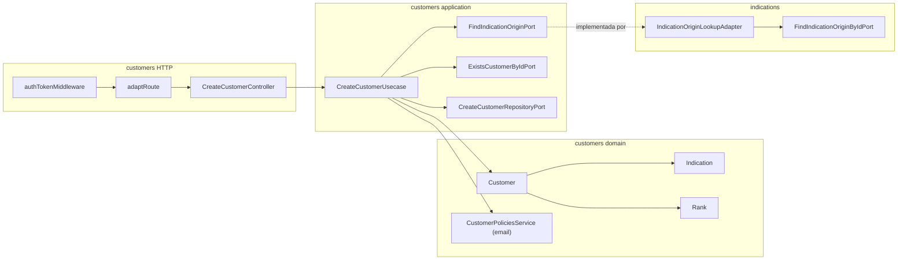

# Design Doc: Rank e Indicação no Cadastro de Customer (v1)

**Status:** Rascunho, formato acordado na sessão de grilling
**Data:** 15/10/2026
**PRD:** [`docs/prd/customer-ranking-indications-v1.md`](../prd/customer-ranking-indications-v1.md) (v1.0)
**Glossário:** [`src/modules/customers/CONTEXT.md`](../../src/modules/customers/CONTEXT.md) (Rank, Indication, Referrer) e [`src/modules/indications/CONTEXT.md`](../../src/modules/indications/CONTEXT.md) (Category, Origin, Channel, Campaign, Friend, Linkable origin)
**Versão em inglês (contrato):** [`customer-ranking-indications-v1.md`](./customer-ranking-indications-v1.md)
**ADRs:** [`docs/adr/customer-ranking-indications/`](../adr/customer-ranking-indications/)
**Constituição:** [`AGENTS.md`](../../AGENTS.md)

Este documento fecha **onde** o trabalho mora no `grau-api`, **quais seams** ele atravessa e **como** o HTTP fica para o frontend. Ele não substitui o PRD nas regras de produto. O arquivo em inglês é o contrato. Este arquivo em português é uma cópia de leitura das mesmas decisões. Os nomes de código, rotas e erros ficam em inglês.

---

## 1. Problema

O PRD define **o quê** deve acontecer. Hoje `customers` não:

1. Guarda rank. `Customer` tem `name`, `email`, `phone`, `nif`, `createdAt`.
2. Guarda indicação. Não há vínculo com Channel, Campaign ou Friend.
3. Recusa com status útil. O `CreateCustomerController` manda todo erro para `serverError` (`500`), inclusive `CustomerAlreadyExistsError`.
4. Depende de `indications`. O `CONTEXT-MAP.md` chama Customers de "independent of this flow".
5. Dá a um `EMPLOYEE` um jeito de escolher uma origem. A leitura do catálogo é só `ADMIN` e `MANAGER`.

A complexidade está em três lugares: o formato da indicação (tudo ou nada, dois formatos), o seam com `indications` (hexágonos não importam o domínio um do outro) e o mapeamento HTTP das recusas.

---

## 2. Objetivos e não-objetivos

### Objetivos v1

- `Customer` guarda um `rank` e uma `indication` opcional.
- O customer **nasce `BRONZE`**. O rank nunca é entrada. Nenhum caminho de código o altera.
- `Indication` é um objeto de valor de `customers` com dois formatos: origem (`canal` ou `campanha` + `originId`) e amigo (`amigo` + `referrerCustomerId`). Um formato incoerente não pode ser construído.
- O create valida tudo antes de gravar. Um `insert` de um documento.
- `customers` consulta `indications` por uma porta de saída própria. Um adapter em `indications` a implementa.
- `indications` ganha uma leitura: origens vinculáveis, para qualquer funcionário autenticado.
- Recusas têm status: `400` para dado ou indicação inválida, `409` para e-mail já usado, `500` só para o inesperado.

### Não-objetivos v1

- Qualquer transição de rank e qualquer endpoint que o altere.
- Listar ou ler customers, filtrar por rank, "Indicou N", seletor de amigo servido pela API.
- Alterar ou remover a indicação depois do create.
- Migração ou backfill (não há customers gravados antes desta feature).
- Transação Mongo ([ADR 0003](../adr/customer-ranking-indications/0003-no-transaction-on-create-customer.md)).
- Índice em `indication.originId` ou `indication.referrerCustomerId`. As leituras que precisam deles ainda não existem.
- Mudar o `requireRoles` da leitura do catálogo ou dos comandos do catálogo.

---

## 3. Linguagem

Use os dois glossários. Não invente termos paralelos.

| Termo | Onde |
|-------|------|
| Customer, Rank, Born Bronze, Indication, Walk-in, Referrer | [`customers/CONTEXT.md`](../../src/modules/customers/CONTEXT.md) |
| Category, Origin, Channel, Campaign, Friend, End, Reopen, Linkable origin | [`indications/CONTEXT.md`](../../src/modules/indications/CONTEXT.md) |

`facts`, `kind` e `ensureOriginIsLinkable` são nomes de implementação, não termos do glossário. "Ausente" significa que a chave não está no body ou seu valor é `null`. Qualquer outro valor, inclusive string vazia, conta como enviado.

---

## 4. Formas consideradas

Fechadas na sessão de grilling. As regras de produto ficam no PRD. Estas são decisões de **formato**.

### Quem constrói a ponte de customers para indications

| | A: adapter em `indications` | B: adapter em `customers` lê `origins` | C: adapter em `app.ts` ou shared |
|--|-----------------------------|----------------------------------------|----------------------------------|
| Dono da regra "ativa" | `indications` | `customers` copia | ninguém |
| Direção do import | `indications` importa uma porta de `customers` | `customers` conhece o schema de origens | os dois importam um arquivo shared |
| Precedente | `auth` atende `employees` | nenhum | nenhum |

**Escolhida: A** ([ADR 0001](../adr/customer-ranking-indications/0001-customers-consult-origins-through-a-port-implemented-by-indications.md)).

### O que a porta responde

| | A: fatos | B: uma decisão |
|--|----------|----------------|
| Resposta | `{ id, categoryId, active }` ou `null` | pode vincular / não pode |
| Quem aplica "existe, mesma categoria, ativa" | `customers` | `indications` |
| Motivo da recusa | conhecido (inexistente, categoria errada, encerrada) | perdido |

**Escolhida: A.** "O que um customer pode vincular" é regra de customer.

### Quem chama a porta e quem decide

| | A: use case carrega, domínio decide | B: domain service com porta em `domain/ports/` | C: policy em `application` |
|--|-------------------------------------|------------------------------------------------|-----------------------------|
| Local da porta | `application/ports/outbound/` | `domain/ports/` | `application/ports/outbound/` |
| Local da regra | método puro em `Indication` | domain service | application service |
| Regra 6 do `AGENTS.md` | respeitada | `indications` importa arquivo do domain de `customers` | respeitada |
| Regra 1 do `AGENTS.md` (domínio puro) | respeitada | respeitada | a regra sai do domínio |

**Escolhida: A.** O use case chama a porta e passa fatos simples para `Indication`. O domínio não chama porta.

### Como a indicação é modelada

| | A: objeto de valor próprio | B: códigos de categoria em `@shared/domain` | C: campos soltos, use case valida |
|--|----------------------------|---------------------------------------------|------------------------------------|
| Combinação incoerente | não pode ser construída | não pode ser construída | a entidade aceita |
| Códigos de categoria | copiados em `customers` | uma fonte | strings |
| Custo agora | nenhum | refatorar `indications` | regras fora do domínio |

**Escolhida: A** ([ADR 0002](../adr/customer-ranking-indications/0002-indication-is-an-embedded-value-object-owned-by-customers.md)).

### Como é gravada

| | A: embutida, ObjectId | B: embutida, ids string | C: coleção separada |
|--|-----------------------|-------------------------|---------------------|
| Gravações no create | 1 | 1 | 2 |
| Tipo nativo para joins futuros | sim | não | sim |
| Tudo ou nada | um documento | um documento | exige transação |

**Escolhida: A.**

### Concorrência

**Escolhida: sem transação** ([ADR 0003](../adr/customer-ranking-indications/0003-no-transaction-on-create-customer.md)). O índice único do e-mail é a rede de segurança, e o erro de chave duplicada vira `CustomerAlreadyExistsError`.

### Onde o formato da indicação é conferido

| | A: controller confere presença, domínio confere combinações | B: controller confere tudo |
|--|-------------------------------------------------------------|-----------------------------|
| Controller | `name`, `email` e `categoryId` quando `indication` vem | tudo |
| Regras de combinação | `Indication.create` | o controller |
| Um segundo ponto de entrada | recebe as regras de graça | repete tudo |

**Escolhida: A.**

### Recusas HTTP

| Situação | Escolhido |
|----------|-----------|
| Nome, e-mail, telefone, nif inválidos; indicação inválida; origem inexistente, de outra categoria ou encerrada; indicador inexistente | `400` |
| E-mail já usado | `409` (hoje é `500`) |
| Falta `name`, `email` ou `indication.categoryId` | `400` `MissingParamError` |
| Inesperado | `500` |
| Sem sessão / sessão inválida | `401` (middleware existente) |

Esta API não tem `404`. Ids desconhecidos continuam `400`, como em `indications` e `employees`.

### Formato da resposta

`{ data: ... }` em todo sucesso, como o resto da API. O exemplo do PRD (`{ id }` e `{ origins }`) era abreviação e foi corrigido.

### Rank

Guardado, nasce `BRONZE`, sem transição ([ADR 0004](../adr/customer-ranking-indications/0004-rank-is-stored-and-born-bronze.md)).

### Como uma leitura futura mostra o nome da origem ou do amigo

| | A: a query compõe por portas | B: `ref` + `populate()` ou `$lookup` | C: nome gravado no create |
|--|------------------------------|---------------------------------------|---------------------------|
| Onde o join acontece | `application/queries/` | o banco ou o Mongoose | nenhum |
| Dado de fora vem de | porta do dono (lote de ids) | a coleção de fora, lida direto | uma cópia no customer |
| Acoplamento com `indications` | uma porta | seu model e schema | nenhum |
| Nome da origem corrigido depois | lido ao vivo | lido ao vivo | desatualizado |

**Escolhida: A** ([ADR 0005](../adr/customer-ranking-indications/0005-cross-module-reads-are-composed-in-the-query-through-ports.md)). Não é construída na v1: este PRD não tem leitura de customers. Aqui só se fixa o padrão, então o schema grava ids `ObjectId` simples **sem** `ref`. A query junta tudo num DTO de leitura, não numa entidade. O nome do indicador vem da porta de leitura do próprio `customers`.

---

## 5. Decisão de formato (v1)

```text
customers domain          → Rank (conjunto fechado, BRONZE | SILVER | GOLD)
                          → Indication (objeto de valor, dois formatos)
                          → Customer (+ rank, + indication)
customers application     → CreateCustomerUsecase (+ checagem de origem e indicador)
                          → FindIndicationOriginPort (saída, implementada por indications)
                          → ExistsCustomerByIdPort (saída, implementada pelo repositório de customers)
customers persistence     → rank + indication embutida, ids ObjectId
customers HTTP            → authTokenMiddleware → adaptRoute (gate inalterado)

indications application   → GetLinkableIndicationOriginsQuery (reaproveita ListIndicationOriginsPort)
indications outbound      → IndicationOriginLookupAdapter (implementa FindIndicationOriginPort)
indications HTTP          → GET /api/indication-linkable-origins, só authTokenMiddleware
```



**Não** importe `@modules/indications/domain` em `customers`. **Não** chame porta de dentro do domínio. **Não** repasse `rank` do body. **Não** crie método que altere o rank.

---

## 6. Como está vs como fica

| Superfície | Hoje | v1 |
|------------|------|----|
| Campos de `Customer` | name, email, phone, nif, createdAt | + `rank`, + `indication` (opcional) |
| Rank | nenhum | `BRONZE` desde o nascimento |
| Body de `POST /api/customer` | name, email, phone?, nif? | + `indication?` |
| Status das recusas | tudo `500` | `400` / `409` / `500` |
| Ordem no `app.ts` | customers, depois indications | indications, depois customers |
| Origens vinculáveis | nenhuma | `GET /api/indication-linkable-origins` |
| `CONTEXT-MAP.md` | Customers independente | Customers depende de Indications por uma porta |

---

## 7. Domínio (customers)

### 7.1 `Rank`

Um conjunto fechado, como `IndicationCategories`, em `domain/rank.ts`.

```ts
type Rank = 'BRONZE' | 'SILVER' | 'GOLD'
```

A ordem da escada é a ordem do array. `INITIAL_RANK` é `'BRONZE'`. Não há método de promoção. Um PRD futuro adiciona a transição.

### 7.2 `Indication`

Objeto de valor em `domain/value-objects/indication.vo.ts`. Dois formatos, como união discriminada:

```ts
type IndicationSnapshot =
  | { categoryId: 'canal' | 'campanha'; originId: string }
  | { categoryId: 'amigo'; referrerCustomerId: string }

type IndicationOriginFacts = { categoryId: string; active: boolean }   // domain/models/
```

`Indication.create(input: { categoryId; originId?; referrerCustomerId? })`:

1. `categoryId` deve ser um dos três códigos, senão `CustomerIndicationInvalidError`.
2. `canal` ou `campanha`: `originId` é obrigatório e `referrerCustomerId` deve estar ausente.
3. `amigo`: `referrerCustomerId` é obrigatório e `originId` deve estar ausente.
4. Um id obrigatório deve ser string e um `UniqueEntityId` válido (hex de 24 caracteres). Id malformado é recusado com `InvalidUniqueEntityIdError`.
5. "Ausente" é chave faltando ou `null`. Qualquer outro valor, inclusive `""`, conta como enviado. Um id que não pertence ao formato, enviado como `""`, é recusado.

Regras puras na instância, chamadas pelo use case com dados simples:

```ts
ensureOriginIsLinkable(facts: IndicationOriginFacts | null): void
ensureReferrerExists(exists: boolean): void
```

| Erro | Quando |
|------|--------|
| `CustomerIndicationOriginNotFoundError` | `facts` é `null` |
| `CustomerIndicationOriginCategoryMismatchError` | `facts.categoryId` difere do `categoryId` da indicação |
| `CustomerIndicationOriginEndedError` | `facts.active` é `false` |
| `CustomerReferrerNotFoundError` | `exists` é `false` |

`ensureOriginIsLinkable` num formato de amigo, e `ensureReferrerExists` num formato de origem, são erro de programação e lançam um `Error` simples. O use case nunca os chama assim.

`Indication.reconstitute(snapshot)` reconstrói a partir da persistência sem revalidar contra o catálogo. `toJSON()` devolve o snapshot.

### 7.3 `Customer`

```ts
Customer.create({ name, email, phone?, nif?, indication? })
  // rank = INITIAL_RANK ('BRONZE'); indication = Indication.create(...) ou null
Customer.reconstitute({ id, name, email, phone, nif, createdAt, rank, indication })
```

`create` não recebe `rank`. `reconstitute` recebe, para que os três ranks possam ser mantidos. `toJSON()` serializa `indication` pelo objeto de valor, e `null` quando ausente.

### 7.4 Erros

| Erro | HTTP | Quando |
|------|------|--------|
| `InvalidNameError`, `InvalidEmailError`, `InvalidPhoneFormatError`, `InvalidNifError` (shared) | `400` | Validação de VO |
| `InvalidUniqueEntityIdError` (shared) | `400` | `originId` ou `referrerCustomerId` malformado |
| `CustomerIndicationInvalidError` | `400` | Categoria desconhecida, id faltando, os dois ids, o id do outro formato, indicação que não é objeto |
| `CustomerIndicationOriginNotFoundError` | `400` | O id da origem não existe |
| `CustomerIndicationOriginCategoryMismatchError` | `400` | A origem é de outra categoria |
| `CustomerIndicationOriginEndedError` | `400` | A origem está encerrada |
| `CustomerReferrerNotFoundError` | `400` | O id do indicador não existe |
| `CustomerAlreadyExistsError` | `409` | E-mail usado, ou chave duplicada `11000` no índice do e-mail |

---

## 8. Application (customers)

### 8.1 DTOs

```ts
interface CreateCustomerIndicationDto {
  categoryId: string
  originId?: string | null
  referrerCustomerId?: string | null
}

interface CreateCustomerDto {
  name: string
  email: string
  phone?: string | null
  nif?: number | null
  indication?: CreateCustomerIndicationDto | null
}

interface CreateCustomerResultDto { id: string }
```

### 8.2 Portas de saída (um método cada, `application/ports/outbound/`)

```ts
interface FindIndicationOriginPort {
  findOrigin(id: string): Promise<IndicationOriginFacts | null>
}

interface ExistsCustomerByIdPort {
  existsById(id: string): Promise<boolean>
}
```

`CreateCustomerRepositoryPort` e `FindCustomerByEmailPort` continuam. O repositório de customers implementa `ExistsCustomerByIdPort`. `indications` implementa `FindIndicationOriginPort`.

### 8.3 Fluxo do create

1. `Customer.create({ name, email, phone, nif, indication })`. Erros de VO, formato da indicação e `rank = BRONZE` acontecem aqui. Depois `.toJSON()` para o snapshot.
2. `ensureEmailIsAvailable(email)`.
3. Formato de origem: `findOrigin(originId)` e depois `indication.ensureOriginIsLinkable(facts)`. Formato de amigo: `existsById(referrerCustomerId)` e depois `indication.ensureReferrerExists(exists)`. Sem indicação: pula.
4. `create(snapshot)`. Chave duplicada no índice do e-mail vira `CustomerAlreadyExistsError`.
5. Devolve `{ id }`.

Nada é gravado antes do passo 4. Uma indicação inválida nunca cria o customer "sem vínculo".

---

## 9. Origens vinculáveis (indications)

Uma query nova em `application/queries/`.

```ts
GetLinkableIndicationOriginsResultDto {
  origins: { id: string; categoryId: 'canal' | 'campanha'; name: string }[]
}
```

`GetLinkableIndicationOriginsQuery` reaproveita o `ListIndicationOriginsPort`. Sem porta de saída nova e sem mudar o repositório. Ela mantém as linhas com `active === true`, ordena Canal primeiro e depois Campanha, e dentro da categoria por `position` e depois `id` (`compareByPositionThenId`). Expõe só `id`, `categoryId`, `name`. Sem origem ativa devolve `origins: []`. Não lê `holdsOrigins`: só existem linhas de `canal` e `campanha`.

### 9.1 `IndicationOriginLookupAdapter`

Em `indications/infrastructure/outbound/`. Implementa `FindIndicationOriginPort` (uma porta de `customers`). Chama `FindIndicationOriginByIdPort`, reconstrói a entidade com `IndicationOriginSnapshotMapper.toEntity` e devolve `{ id, categoryId, active }` usando o `active` da entidade. Inexistente ou id inválido é `null`. Não duplica a regra dos intervalos.

`makeIndicationsModule` o devolve como `findIndicationOrigin`. O `app.ts` o injeta.

---

## 10. HTTP

```text
POST /api/customer                         authTokenMiddleware → adaptRoute            (gate inalterado)
GET  /api/indication-linkable-origins      authTokenMiddleware → adaptRoute            (sem requireRoles)
```

### 10.1 `POST /api/customer`

Body cru em `presentation/http/create-customer.request.ts`:

```ts
interface CreateCustomerRequest {
  name: string
  email: string
  phone?: string | null
  nif?: number | null
  indication?: { categoryId: string; originId?: string | null; referrerCustomerId?: string | null } | null
}
```

Passos do controller:

1. `validationRequiredFields(request, ['name', 'email'])`. Falta é `badRequest(new MissingParamError(field))`.
2. `indication` ausente ou `null`: sem indicação.
3. `indication` enviada mas não objeto (string, número, array): `badRequest(new CustomerIndicationInvalidError())`.
4. `indication` objeto: `validationRequiredFields(request.indication, ['categoryId'])`. Falta é `MissingParamError('indication.categoryId')`.
5. Repassa `{ name, email, phone, nif, indication: { categoryId, originId, referrerCustomerId } }`. Um `rank`, ou qualquer chave desconhecida, no body ou dentro de `indication`, não é repassado.
6. Sucesso `created({ id })`.

O mapeamento de erros fica no controller, como no `CreateIndicationOriginController`.

```http
POST /api/customer
Authorization: Bearer <token>
{ "name": "Maria Silva", "email": "maria@example.com",
  "indication": { "categoryId": "canal", "originId": "<24-hex>" } }
→ 201 { "data": { "id": "<24-hex>" } }
```

```http
POST /api/customer
{ "name": "João Costa", "email": "joao@example.com",
  "indication": { "categoryId": "amigo", "referrerCustomerId": "<24-hex>" } }
→ 201
```

```http
POST /api/customer
{ "name": "Ana Reis", "email": "ana@example.com" }
→ 201   (sem indicação, rank BRONZE)
```

| Situação | HTTP |
|----------|------|
| Criado, com ou sem indicação | `201` `{ data: { id } }` |
| Falta `name`, `email` ou `indication.categoryId` | `400` |
| Nome, e-mail, telefone, nif inválidos | `400` |
| Categoria desconhecida; formato incoerente; id malformado | `400` |
| Origem inexistente, de outra categoria ou encerrada; indicador inexistente | `400` |
| E-mail já usado | `409` |
| Sem sessão / sessão inválida | `401` |
| Inesperado | `500` |

### 10.2 `GET /api/indication-linkable-origins`

```http
GET /api/indication-linkable-origins
Authorization: Bearer <token>
→ 200 { "data": { "origins": [ { "id": "...", "categoryId": "canal", "name": "Instagram" } ] } }
```

| Situação | HTTP |
|----------|------|
| Ok, inclusive lista vazia | `200` |
| Sem sessão / sessão inválida | `401` |
| Inesperado | `500` |

`EMPLOYEE`, `MANAGER` e `ADMIN` passam. A leitura do catálogo e todo comando do catálogo continuam `ADMIN` e `MANAGER`.

---

## 11. Persistência (customers)

```ts
{
  name: string
  email: string                      // índice único, como hoje
  phone: string | null
  nif: number
  createdAt: Date
  rank: 'BRONZE' | 'SILVER' | 'GOLD' // obrigatório, enum no schema
  indication?: {                     // ausente quando não há indicação
    categoryId: 'canal' | 'campanha' | 'amigo'
    originId?: ObjectId              // formato de origem
    referrerCustomerId?: ObjectId    // formato de amigo
  }                                  // sem _id no subdocumento
}
```

Sem índice nos campos do subdocumento. Sem migração: não existem customers antes desta feature.

| Método | Comportamento |
|--------|---------------|
| `create` | Grava o snapshot. Chave duplicada `11000` no e-mail vira `CustomerAlreadyExistsError` |
| `findByEmail` | Como hoje, mapeando `rank` e `indication` |
| `existsById` | `true` quando algum customer tem esse `_id`. Id malformado é `false` |

O mapper converte `originId` e `referrerCustomerId` em `ObjectId` na escrita e em string na leitura. Mantém tipos do Mongoose fora do domínio. Não persista `toJSON()` às cegas: mapeie explicitamente.

---

## 12. Wiring

- `makeIndicationsModule` também monta o `IndicationOriginLookupAdapter`, a query vinculável e seu controller, e devolve `findIndicationOrigin`. O router ganha a rota vinculável só com `authTokenMiddleware`.
- `makeCustomersModule({ connection, authTokenMiddleware, findIndicationOrigin })`. Monta um `CustomerMongooseRepository` e o `CustomerPoliciesService`, e depois `CreateCustomerUsecase(customerPoliciesService, findIndicationOrigin, repository /* ExistsCustomerByIdPort */, repository /* CreateCustomerRepositoryPort */)`.
- `app.ts` monta `indications` antes de `customers` e passa `indications.findIndicationOrigin`.

Exemplos manuais: `src/client/customer.http` (origem, amigo, sem indicação, cada recusa) e `src/client/indication.http` (origens vinculáveis).

---

## 13. Sequências

**Create com origem**

```text
Client
  → authTokenMiddleware → adaptRoute
  → CreateCustomerController (campos obrigatórios, indication.categoryId)
  → CreateCustomerUsecase
      → Customer.create (VOs, Indication.create, rank BRONZE) → toJSON
      → CustomerPoliciesService.ensureEmailIsAvailable
      → FindIndicationOriginPort.findOrigin   ⇢ IndicationOriginLookupAdapter ⇢ indications
      → Indication.ensureOriginIsLinkable(facts)
      → CreateCustomerRepositoryPort.create   (11000 → CustomerAlreadyExistsError)
  → 201 { data: { id } } | 400 | 409
```

**Create com amigo**

```text
  ... Customer.create → ensureEmailIsAvailable
      → ExistsCustomerByIdPort.existsById
      → Indication.ensureReferrerExists(exists)
      → create
```

**Origens vinculáveis**

```text
Client → authTokenMiddleware → adaptRoute
  → GetLinkableIndicationOriginsController
  → GetLinkableIndicationOriginsQuery
      → ListIndicationOriginsPort.list
      → mantém ativas, ordena Canal primeiro, depois position, depois id
  → 200 { data: { origins } }
```

---

## 14. Fatias de implementação (playbook da API)

Siga os passos de novo comando e nova query do [`AGENTS.md`](../../AGENTS.md). Uma fatia por vez.

| Fatia | Entrega | Não entrega |
|-------|---------|-------------|
| **0: Domínio de customers** | `Rank`; `Indication` + tipo de fatos; `Customer` com rank e indicação; os erros novos; specs | Mongo, HTTP, use case |
| **1: Persistência de customers** | Schema (`rank`, `indication`), mapper, `existsById`, `11000` para `CustomerAlreadyExistsError`; specs | Use case, controller |
| **2: Application de customers** | DTOs, as duas portas de saída, mudanças no `CreateCustomerUsecase` + spec | Controller, wiring |
| **3: HTTP de customers** | `create-customer.request.ts`, controller (mapeamento + validação aninhada) + spec, `customer.http` | Wiring, indications |
| **4: Indications** | Query vinculável, DTO, porta de entrada, controller, rota; `IndicationOriginLookupAdapter` + specs; `indication.http` | Wiring de customers |
| **5: Wiring e docs** | `customers.module.ts`, `indications.module.ts`, reordenar `app.ts`; `customers/AGENT.md`, `indications/AGENT.md`, `CONTEXT-MAP.md` | |

`1` e `2` precisam de `0`. `3` precisa de `2`. `4` é independente de `0` a `3`, exceto que o adapter implementa a porta da `2`. `5` precisa de `2`, `3` e `4`.

Contratos de implementação: [`docs/specs/customer-ranking-indications/`](../specs/customer-ranking-indications/README.md).

---

## 15. Notas da entrevista (grilling de backend)

As regras de produto estão no PRD. Estas foram decisões de **formato**:

- **O adapter mora no provedor.** `customers` declara a pergunta e `indications` responde, como `auth` faz para `employees`. Quem manda nos dados continua mandando na regra "ativa".
- **Fatos, não veredito.** O motivo da recusa é regra e mensagem de customer.
- **O use case chama a porta, o domínio decide.** É assim que a regra 6 (sem import de domínio alheio) e a regra 1 (domínio puro) convivem. A policy de e-mail mantém a porta no domínio porque os dois lados moram em `customers`.
- **Um objeto de valor, com cópia de três palavras.** A cópia custa menos que refatorar `indications` agora.
- **Sem transação.** Grava-se um documento. A janela não causa dano.
- **`409` é novo no create customer.** E-mail já usado era `500`. É uma mudança pequena e intencional de comportamento.
- **`""` conta como enviado.** Só ausente ou `null` significa "não enviado". Evita aceitar lixo em silêncio.
- **`{ data }` em tudo.** A abreviação do PRD foi corrigida.
- **Sem `ref` no schema.** Os ids são `ObjectId` para uma leitura futura poder juntar, mas o padrão dessa leitura é compor na query por portas (ADR 0005). O `populate` acoplaria `customers` ao model de `indications`.
- **Reaproveitar `ListIndicationOriginsPort`.** A leitura vinculável é um filtro sobre linhas que já trazem `active`. Uma porta nova criaria um método sem dado novo.

---

## 16. Mapeamento de aceite (API)

Espelha o PRD §7 na fronteira HTTP:

- [ ] `POST /api/customer` sem `indication` → `201`; `rank` gravado é `BRONZE`; sem campo `indication`.
- [ ] Com qualquer indicação válida → `201`; `rank` gravado é `BRONZE`.
- [ ] Um `rank` no body (qualquer valor) → ignorado; `rank` gravado é `BRONZE`.
- [ ] `canal` com canal ativo → `201`, vinculado. `campanha` com campanha ativa → `201`, vinculado.
- [ ] `amigo` com id de customer existente → `201`, vinculado.
- [ ] Origem encerrada, inexistente, de outra categoria, ou `originId` faltando → `400`, nada gravado.
- [ ] `referrerCustomerId` inexistente ou faltando em `amigo` → `400`, nada gravado.
- [ ] `originId` em `amigo`, ou `referrerCustomerId` em `canal` ou `campanha` (inclusive `""`) → `400`, nada gravado.
- [ ] `categoryId` desconhecida, `indication` sem `categoryId`, ou `indication` que não é objeto → `400`, nada gravado.
- [ ] E-mail duplicado, com ou sem indicação → `409`, nada gravado. Duplicata concorrente que chega ao índice → `409`.
- [ ] Encerrar uma origem depois de vincular não altera o customer vinculado.
- [ ] `GET /api/indication-linkable-origins` devolve só origens ativas de Canal e Campanha (`id`, `categoryId`, `name`), Canal primeiro, depois Campanha, cada uma na ordem de criação. Sem origem ativa → `origins: []`.
- [ ] `EMPLOYEE` → `201` no create e `200` na leitura vinculável; `403` na leitura do catálogo e em todo comando do catálogo. Sem sessão → `401` em tudo.
- [ ] Nenhum método, use case ou rota altera um rank.
