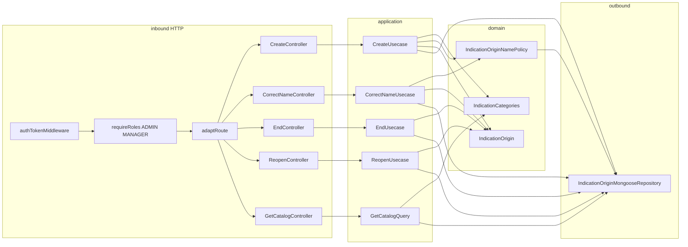

# Design Doc: Indication Catalog (v1)

**Status:** Draft — backend shape  
**Date:** 07/10/2026  
**PRD:** [`docs/prd/indication-catalog-v1.md`](../prd/indication-catalog-v1.md) (v1.1)  
**Glossary:** [`src/modules/indications/CONTEXT.md`](../../src/modules/indications/CONTEXT.md)  
**Reading copy:** [`indication-catalog-v1.pt.md`](./indication-catalog-v1.pt.md)  
**ADRs:** [`docs/adr/indication-catalog/`](../adr/indication-catalog/)  
**Constitution:** [`AGENTS.md`](../../AGENTS.md)

This document closes **where** the Indication Catalog lives in `grau-api`, **which seams** it crosses, and **how** HTTP looks for the frontend. It does **not** replace the PRD for product copy or Vue screens. The English file is the contract. The Portuguese file is a reading copy of the same decisions.

There is no `AGENT.md` yet. The living contract is written after the HTTP slice stabilizes, not on day zero.

---

## 1. Problem

The PRD already defines **what** must happen. The indications context today does **not**:

1. Exist as a hexagon. `src/modules/indications/` holds only [`CONTEXT.md`](../../src/modules/indications/CONTEXT.md).
2. Store an origin. There is no collection, no create, no correct-the-name, no end, no reopen.
3. Expose the three categories. Canal, Campanha, and Amigo are screen labels, not an API.
4. Refuse `EMPLOYEE` on this surface. Gestão screens for collaborators already do, at the route.

The prototype paints Instagram, TikTok, and Google inside Canal, offers “Nova categoria”, and joins customers in the browser. None of that is this version. Canal and Campanha start empty. Amigo never holds an origin.

Complexity (closed categories, a name reserved inside one category including when the origin is ended, birth order, active time kept for a later board) sits in the **indications** hexagon. The catalog read does not compute days.

---

## 2. Objectives and non-goals

### Objectives v1

- New hexagon `src/modules/indications`. One collection, one repository: origins.
- Categories are a closed code set: `canal`, `campanha`, `amigo`, with `holdsOrigins` and a fixed order. No category collection and no category repository.
- Canal and Campanha start with no origins. Startup inserts nothing.
- Commands: create, correct the name, end, reopen. Query: the catalog.
- Name uses shared `Name` (trim, collapsed spaces, 2–100). Reservation is case-insensitive inside the category, including ended origins, via `name` + `nameKey` and a unique index `(categoryId, nameKey)`.
- Birth order is `position`, assigned at create as max-in-category + 1.
- Active time is `intervals: [{ from, to }]` on the origin document. `createdAt` is the `from` of the first interval and does not change. `active` is derived: the last interval has `to === null`.
- HTTP gate: `authTokenMiddleware` + `requireRoles('ADMIN', 'MANAGER')`. Use cases do not load the actor.
- Catalog `GET` returns the three categories, each with its origins. It does not return `position`, intervals, `nameKey`, or a day count.
- HTTP the frontend can branch on: `201` / `200` / `400` / `401` / `403` / `409`.

### Non-goals v1

- Creating, renaming, or removing a category.
- Deleting an origin, or moving it to the other category.
- An origin in Amigo.
- Seeding Instagram, TikTok, Google, or any campaign.
- The board: last entry, pace, quality, signal, brief, period, search, attention order, and the day count.
- Returning intervals or days on this `GET`.
- A field on Customer. Rank. The friend row.
- A domain policy for the role matrix. `requireRoles` is the gate.
- `AGENT.md` before the HTTP slice is stable.

---

## 3. Language

Use the indications glossary. Do not invent parallel terms.

| Term | In this hexagon |
|------|-----------------|
| Category / Origin / Channel / Campaign / Friend / End / Reopen / Correct the name | [`CONTEXT.md`](../../src/modules/indications/CONTEXT.md) |

`nameKey`, `position`, `intervals`, and `holdsOrigins` are implementation names, not glossary terms. `holdsOrigins` is how the constant says Amigo keeps no origins. A magic id is not the rule.

`active` on the read is “the origin is offered”. It is true when the last interval is open.

---

## 4. Forms considered

Closed in the grilling session. Product rules stay in the PRD (v1.1); these are **shape** decisions.

### Where Category lives

| | A — persisted documents | B — closed code set | C — one Catalog document |
|--|-------------------------|---------------------|--------------------------|
| What is stored | Category and Origin | Origin only | categories and origins embedded |
| How Amigo is refused | `holdsOrigins` on the document | the same flag on the constant | the same flag inside the aggregate |
| Category id | generated on first seed | stable code | stable inside the document |

**Chosen: B** ([ADR 0001](../adr/indication-catalog/0001-categories-are-a-closed-code-set.md)). `canal`, `campanha`, `amigo`. `holdsOrigins` is true, true, false. Order is 1, 2, 3. The read projects the three categories from the constant and hangs origins on them. Create resolves `categoryId` on that constant.

Category ids are **codes**, not `UniqueEntityId`. That VO accepts only 24-character hex and would reject `canal`. Origin ids are `UniqueEntityId`.

### What a fresh Canal contains

| | A — Instagram, TikTok, Google seeded | B — Canal empty, same as Campanha |
|--|--------------------------------------|-----------------------------------|
| First read | three channels already there | three categories, zero origins |
| Boot | insert-if-missing | inserts nothing |

**Chosen: B** ([ADR 0002](../adr/indication-catalog/0002-canal-is-born-empty.md)). PRD 1.1 and the glossary say the same thing. No `bornKey`. No seed function.

### How the reserved name is stored

| | A — `name` + `nameKey` | B — collation index | C — read-before-write only |
|--|------------------------|---------------------|----------------------------|
| Uniqueness | unique `(categoryId, nameKey)` | unique `(categoryId, name)` with a case-insensitive collation | the application reads and refuses |
| Two creates at once | the index refuses the second | the index refuses the second | both can insert |
| “Verão” and “Verao” | stay distinct | depend on the collation | stay distinct |

**Chosen: A** ([ADR 0004](../adr/indication-catalog/0004-reserved-name-is-a-name-key.md)). `nameKey` is the normalized `Name` lowercased with `String#toLowerCase` (Unicode default case fold, not a locale). Accents stay distinct: the PRD only folds case.

### Where the name check lives

| | A — domain service + port | B — use case queries the repository | C — unique index only |
|--|---------------------------|-------------------------------------|------------------------|
| Who applies “ended still reserves” | the domain, before the write | the application | Mongo, at insert |
| Correct to the same key | the caller skips the write | the use case skips | the update does not change the key |
| Error the controller sees | one domain error → `409` | the use case translates | a driver error translated to `409` |

**Chosen: A.** Same shape as `EmployeePoliciesService.ensureEmailIsAvailable`. Create and correct call one method. A duplicate key that wins the race becomes the same error.

### Birth order

| | A — `position` | B — `createdAt` | C — array order on the category |
|--|----------------|-----------------|----------------------------------|
| Place | integer per category, set at create | insertion clock | index inside a category document |
| Create | `max(position) + 1` in the category, or `1` | the insert timestamp | append |

**Chosen: A.** `createdAt` measures time. `position` is the catalog order. Correct, end, and reopen do not change `position`. Two creates that both read the same max both insert; the read breaks the tie with `_id`. There is no unique index on `position`.

### Active time

| | A — age from `createdAt` | B — one accumulated total | C — `{ from, to }` intervals |
|--|--------------------------|---------------------------|------------------------------|
| Ended days | counted | left out | left out |
| A later period cut | cannot | cannot | intersection with the stretches |

**Chosen: C** ([ADR 0003](../adr/indication-catalog/0003-active-time-is-an-interval-list.md)). The array lives **on the origin document**. One collection, one repository. The catalog `GET` does not return the intervals or a day count.

### Who may call

| | A — `requireRoles` on the route | B — domain policy | C — both |
|--|---------------------------------|-------------------|----------|
| Where the role is read | JWT, before the controller | the use case loads the employee | route and use case |
| Use case | does not know the actor | receives `actorId` | duplicates the rule |

**Chosen: A.** The matrix is flat: `ADMIN` and `MANAGER` pass, `EMPLOYEE` does not. No target, no Last Admin. Same gate as `GET /employees` and `POST /employee`.

### Catalog `GET` shape

| | A — origins nested in the category | B — two sibling lists |
|--|------------------------------------|------------------------|
| Body | `categories[].origins` | `categories` and `origins` |
| Empty Campanha and Amigo | `"origins": []` | the category is present and no origin carries that id |

**Chosen: A.** The screen is three groups. Category order comes from the constant. `holdsOrigins` stays on the category, so the create form can keep Amigo out while Campanha is also empty. Each origin still carries `categoryId`, as the PRD requires.

### HTTP refusals

| Situation | Chosen |
|-----------|--------|
| Invalid name, missing field, unknown category, create into Amigo, unknown origin id | `400` |
| Name already reserved in the category, active or ended | `409` |
| End again, reopen again, correct onto the same normalized name | `200`, no further write |
| Create success | `201` `{ data: { id } }` |
| Correct, end, reopen success | `200` `{ data: { id } }` |
| Missing or invalid session | `401` (existing auth middleware) |
| `EMPLOYEE` | `403` (`requireRoles`) |

Unknown ids stay `400`, matching `EmployeeNotFoundError`. Occupancy stays `409`, matching `EmployeeAlreadyExistsError` on main-data correction. This API has no `404`.

---

## 5. Decision of form (v1)

```text
indications domain        → IndicationCategories (code)
                          → IndicationOrigin
                          → IndicationOriginNamePolicy + port
indications application   → Create / CorrectName / End / Reopen
                          → GetIndicationCatalogQuery
indications persistence   → one origins collection
                          → unique (categoryId, nameKey)
                          → intervals embedded
indications HTTP          → authTokenMiddleware
                          → requireRoles('ADMIN', 'MANAGER')
                          → adaptRoute
```



Do **not** add a category repository. Do **not** seed origins on boot. Do **not** call the repository from a controller. Do **not** return intervals on the catalog read.

---

## 6. As-is vs to-be (this hexagon)

| Surface | Today | v1 |
|---------|--------|----|
| Module | `CONTEXT.md` only | full hexagon |
| Categories | screen labels | code constant, three ids |
| Origins | none | one collection, empty until create |
| Boot | — | does not insert origins |
| Catalog read | none | `GET /api/indication-catalog` |
| Create / correct / end / reopen | none | the four routes below |
| Role gate | — | `requireRoles('ADMIN', 'MANAGER')` |

---

## 7. Domain

### 7.1 `IndicationCategories`

```ts
type IndicationCategoryId = 'canal' | 'campanha' | 'amigo'

type IndicationCategory = {
  id: IndicationCategoryId
  name: 'Canal' | 'Campanha' | 'Amigo'
  order: 1 | 2 | 3
  holdsOrigins: boolean
}
```

| id | name | order | holdsOrigins |
|----|------|-------|----------------|
| `canal` | Canal | 1 | true |
| `campanha` | Campanha | 2 | true |
| `amigo` | Amigo | 3 | false |

`list()` returns the three, in `order`. `find(id)` returns the category or nothing. Callers treat “nothing” and “`holdsOrigins === false`” as different errors (unknown vs Amigo).

### 7.2 `IndicationOrigin`

```ts
correctName(name: Name): boolean   // false when nameKey is unchanged
end(): boolean                      // false when the last interval is already closed
reopen(): boolean                   // false when the last interval is already open
```

`end` and `reopen` stamp `new Date()` inside the entity, the same way `Employee` stamps `deactivateAt` and `removedAt`.

Create builds one open interval `{ from: createdAt, to: null }` with `createdAt = new Date()`. `createdAt` is not written again. `correctName` changes `name` and `nameKey` only. `end` sets `to` on the open interval. `reopen` appends `{ from: now, to: null }`. A repeated end or reopen returns `false` and leaves the array as it was.

`active` is `intervals.at(-1).to === null`. An origin always has at least one interval. There is no stored `active` flag.

`static nameKeyFrom(name: Name): string` is `name.value.toLowerCase()`.

### 7.3 `IndicationOriginNamePolicy`

Domain service. Port: `IndicationOriginNameAvailabilityPort` in `domain/ports/` (the repository implements it).

```ts
ensureAvailable(input: {
  categoryId: IndicationCategoryId
  nameKey: string
  exceptOriginId?: string
}): Promise<void>
```

The port reports whether another origin in that category already holds `nameKey`. `exceptOriginId` excludes the origin being corrected. A hit throws `IndicationOriginNameTakenError`. Ended origins count: the query does not filter them out.

Create calls it with no `exceptOriginId`. Correct calls it only when `correctName` would change the key. When the key is unchanged, the use case does not call the policy and does not write.

### 7.4 Errors

| Error | HTTP | When |
|-------|------|------|
| `InvalidNameError` (shared `Name`) | `400` | Empty, shorter than 2, longer than 100, after normalization |
| `IndicationCategoryUnknownError` | `400` | `categoryId` is not one of the three codes |
| `IndicationCategoryDoesNotHoldOriginsError` | `400` | Category is Amigo |
| `IndicationOriginNotFoundError` | `400` | Correct, end, or reopen id misses |
| `IndicationOriginNameTakenError` | `409` | `nameKey` held in the category, or Mongo `11000` on that index |

---

## 8. Application

Commands and the query share the hexagon. The query does not reconstitute `IndicationOrigin`, does not call the name policy, and does not see intervals.

### 8.1 Create

```ts
CreateIndicationOriginDto { categoryId: string; name: string }
CreateIndicationOriginResultDto { id: string }
```

1. `IndicationCategories.find(categoryId)` — miss → `IndicationCategoryUnknownError`.
2. `holdsOrigins === false` → `IndicationCategoryDoesNotHoldOriginsError`.
3. `Name.create(name)` → `nameKeyFrom`.
4. `ensureAvailable({ categoryId, nameKey })`.
5. `nextPosition(categoryId)` → max `position` in that category + 1, or `1`.
6. `IndicationOrigin.create` and insert.
7. Duplicate key on `(categoryId, nameKey)` → `IndicationOriginNameTakenError`.
8. Return `{ id }`.

### 8.2 Correct the name

```ts
CorrectIndicationOriginNameDto { id: string; name: string }
CorrectIndicationOriginNameResultDto { id: string }
```

1. Load by id — miss → `IndicationOriginNotFoundError`. Reconstitute. Do not use `create`.
2. `Name.create(name)`.
3. `correctName` returns `false` → return `{ id }` and do not write.
4. `ensureAvailable({ categoryId, nameKey, exceptOriginId: id })`.
5. `$set` `{ name, nameKey }` only. `categoryId`, `position`, `createdAt`, and `intervals` stay.
6. Duplicate key → `IndicationOriginNameTakenError`.
7. Return `{ id }`.

Correcting an ended origin is allowed. The origin stays ended.

### 8.3 End and reopen

```ts
EndIndicationOriginDto { id: string }
ReopenIndicationOriginDto { id: string }
```

Both return `{ id: string }`.

1. Load — miss → `IndicationOriginNotFoundError`.
2. `end()` or `reopen()`. `false` → return `{ id }` and do not write.
3. `$set` `{ intervals }` from the entity. Do not `$set` the whole document. Do not `toJSON()`.
4. Return `{ id }`.

### 8.4 Catalog query

Outbound read port returns rows `{ id, categoryId, name, position, active }`. The repository derives `active` from the last interval. The query does not receive `intervals` or `nameKey`.

The query walks `IndicationCategories.list()` and, for each category, attaches the rows with that `categoryId`, sorted by `position` then `id`. A category with no rows still appears, with `origins: []`.

---

## 9. HTTP (frontend contract)

All five routes:

```text
authTokenMiddleware → requireRoles('ADMIN', 'MANAGER') → adaptRoute
```

```http
GET /api/indication-catalog
Authorization: Bearer <token>
```

```http
POST /api/indication-origin
Authorization: Bearer <token>
{ "categoryId": "canal", "name": "Facebook" }
```

`categoryId` is `canal` or `campanha`. `amigo` is `400`.

```http
PATCH /api/indication-origin/:id
Authorization: Bearer <token>
{ "name": "Instagram Ads" }
```

```http
POST /api/indication-origin/:id/end
Authorization: Bearer <token>
```

```http
POST /api/indication-origin/:id/reopen
Authorization: Bearer <token>
```

End and reopen have no body.

Success body for every write is `{ data: { id } }`. Create is `201` (`created`). The others are `200` (`ok`).

Catalog success is `200`:

```json
{
  "data": {
    "categories": [
      {
        "id": "canal",
        "name": "Canal",
        "holdsOrigins": true,
        "origins": [
          {
            "id": "<24-hex>",
            "categoryId": "canal",
            "name": "Facebook",
            "active": true
          }
        ]
      },
      {
        "id": "campanha",
        "name": "Campanha",
        "holdsOrigins": true,
        "origins": []
      },
      {
        "id": "amigo",
        "name": "Amigo",
        "holdsOrigins": false,
        "origins": []
      }
    ]
  }
}
```

| Situation | HTTP |
|-----------|------|
| Create ok | `201` `{ data: { id } }` |
| Correct / end / reopen ok, including no-op | `200` `{ data: { id } }` |
| Catalog ok | `200` `{ data: { categories } }` |
| Missing `categoryId` or `name`; blank name; name length; unknown category; Amigo; unknown origin id | `400` |
| Name reserved in the category | `409` |
| No / invalid session | `401` |
| `EMPLOYEE` | `403` |
| Unexpected | `500` |

Controllers stay Express-free. Raw bodies live in `presentation/http/`. Do not send `actorId`. The use cases ignore it if `adaptRoute` stamped it.

`:id` wins over a body `id`. Unknown keys on create and correct are ignored. A correct body without `name` is `400`.

---

## 10. Persistence

One Mongoose model, collection of origins. No category collection. No interval collection. No seed.

```ts
{
  categoryId: 'canal' | 'campanha'   // required; amigo is not a stored value
  name: string                       // required, Name.value
  nameKey: string                    // required
  position: number                   // required, integer ≥ 1
  createdAt: Date                    // required, set once
  intervals: [{ from: Date, to: Date | null }]
}
```

**Index:** unique `{ categoryId: 1, nameKey: 1 }`.

No unique index on `position`. No `active` column. No `bornKey`.

| Method | Behaviour |
|--------|-----------|
| `insert` | the create snapshot. `11000` → `IndicationOriginNameTakenError` |
| `updateName` | `$set` `{ name, nameKey }`. `11000` → the same error |
| `updateIntervals` | `$set` `{ intervals }` only |
| `existsByNameKey` | match `categoryId` + `nameKey`; optional `_id: { $ne: exceptOriginId }` |
| `nextPosition` | max `position` for `categoryId`, plus 1; `1` when none |
| `findById` | write load, including intervals |
| `list` | read rows `{ id, categoryId, name, position, active }`, `active` from the last interval |

Mapper keeps Mongoose types out of the domain. Do not persist `toJSON()`.

`categoryId` on the schema is the enum `canal | campanha`, so a direct insert of `amigo` fails in the adapter as well as in the domain.

---

## 11. Wiring

`makeIndicationsModule({ connection, authTokenMiddleware, makeRequireRoles })`.

`app.ts` mounts `app.use('/api', indications.router)` next to employees and customers. The module does not take the encrypter, the mailer, or a compare-hash port.

Composition:

1. Model + `IndicationOriginMongooseRepository` (write ports, name-availability port, read port, `nextPosition`).
2. `IndicationOriginNamePolicy(repository)`.
3. Four use cases + `GetIndicationCatalogQuery`.
4. Five controllers.
5. `makeIndicationRoutes` with `authTokenMiddleware` and `requireRoles('ADMIN', 'MANAGER')` on every route.

Manual samples: `src/client/indication.http`.

`AGENT.md` is updated in the HTTP slice, once the routes exist. Not before.

---

## 12. Sequences

**Create**

```text
Client
  → authTokenMiddleware → requireRoles → adaptRoute
  → CreateIndicationOriginController
  → CreateIndicationOriginUsecase
      → IndicationCategories.find
      → Name.create → nameKeyFrom
      → IndicationOriginNamePolicy.ensureAvailable
      → nextPosition
      → IndicationOrigin.create
      → insert
  → 201 { data: { id } } | 400 | 409
```

**Correct the name**

```text
Client
  → CorrectIndicationOriginNameController
  → CorrectIndicationOriginNameUsecase
      → findById → reconstitute
      → Name.create
      → correctName — false: return, no write
      → ensureAvailable(exceptOriginId)
      → updateName $set { name, nameKey }
  → 200 { data: { id } } | 400 | 409
```

**End / reopen**

```text
Client
  → EndController | ReopenController
  → use case
      → findById → reconstitute
      → end | reopen — false: return, no write
      → updateIntervals $set { intervals }
  → 200 { data: { id } } | 400
```

**Catalog**

```text
Client
  → GetIndicationCatalogController
  → GetIndicationCatalogQuery
      → IndicationCategories.list
      → list origins
      → group by categoryId, sort position then id
  → 200 { data: { categories } }
```

---

## 13. Implementation slices (API playbook)

Follow [`AGENTS.md`](../../AGENTS.md) new-module, new-command, and new-query steps. Specs: [`docs/specs/indication-catalog/`](../specs/indication-catalog/README.md). One slice at a time.

| Slice | Ships | Does not ship |
|-------|--------|----------------|
| **0 — Domain** | `IndicationCategories`; `IndicationOrigin` (`create`, `reconstitute`, `correctName`, `end`, `reopen`, `nameKeyFrom`); errors; `IndicationOriginNamePolicy` + availability port + specs | Mongo, HTTP, routes |
| **1 — Persistence** | Schema, mapper, repository methods in §10, including `11000` → name-taken, + specs | Use cases, controllers |
| **2 — Commands** | Four use cases, DTOs, inbound/outbound ports + specs. No-op correct/end/reopen does not write | Controller, `app.ts` |
| **3 — Query** | Read port DTO without intervals; `GetIndicationCatalogQuery` groups the constant with the rows + spec | HTTP |
| **4 — HTTP** | Five controllers, routes, `makeIndicationsModule`, `app.ts`, `src/client/indication.http`, `AGENT.md` | Board, customer fields, day count |

`1` does not need `2`. `2` needs `0` and `1`. `3` needs `1`. `4` needs `2` and `3`.

---

## 14. Interview notes (backend grilling)

Product rules live in the PRD. These were **shape** decisions:

- **Categories in code** — they are closed, like `Role`. A collection would store three rows that never change. Amigo is refused because `holdsOrigins` is false, not because the id string is special. The id is still the code `amigo`, and it is not a `UniqueEntityId`.
- **Canal empty** — the prototype labels are not defaults. Boot does not insert. There is no `bornKey` and no second collection.
- **`name` + `nameKey`** — display keeps case; the unique index does not. Collation would hide the fold in the database. The check lives in a domain service, with the index as the race backstop, same error class.
- **`position` and `createdAt` do different jobs** — order is the integer; the clock is the first interval. The `GET` returns neither the integer nor the stretches.
- **Intervals on the origin** — the later board can cut a period. A single accumulated total cannot. A second collection is not worth a second repository for a short array.
- **`requireRoles` only** — the matrix has no target. A domain policy would load an employee to repeat the JWT check.
- **Nested `GET`** — the screen is three groups. `holdsOrigins` is what keeps Amigo off the create form when every list is empty.
- **`400` / `409`** — same split as collaborator not-found vs email taken. Repeated end, reopen, and same-name correct are `200`.

---

## 15. Acceptance mapping (API)

Mirrors PRD §7 at the HTTP boundary:

- [ ] Fresh process, empty collection: `GET` returns Canal, Campanha, Amigo, in that order, each with `origins: []`. Boot inserted nothing.
- [ ] `ADMIN` or `MANAGER` creates a channel and a campaign; each is last in its category; `GET` includes them. The first origin in an empty category has `position` 1.
- [ ] Create with `categoryId: "amigo"` → `400`, no write. Unknown `categoryId` → `400`, no write.
- [ ] Name that normalizes to fewer than 2 or more than 100 characters → `400`. Name of only spaces → `400`.
- [ ] Same `nameKey` in the category, any letter case, holder active or ended → `409`, no write. The same name in the other category → `201`.
- [ ] `"Google  Ads"` then `"Google Ads"` in the same category → the second is `409`.
- [ ] Correct keeps the id and the category. The previous `nameKey` becomes free. Correct onto another origin’s key in the category → `409`, original name unchanged.
- [ ] Correct to the same name, including spacing and case only → `200`, no write.
- [ ] End keeps the origin on `GET`, `active: false`, same name. A second end → `200`, intervals unchanged. Reopen → `active: true`. A second reopen → `200`, no new interval.
- [ ] End, reopen, and correct of an unknown id → `400`.
- [ ] `EMPLOYEE` on `GET` and on every write → `403`. No session → `401`.
- [ ] `GET` origin objects are `id`, `categoryId`, `name`, `active` only.
