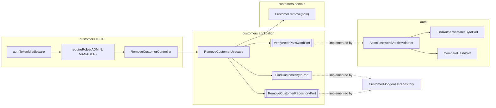

# Design Doc: Remove Customer (v1)

**Status:** Approved
**Date:** 11/11/2026
**PRD:** [`docs/prd/remove-customer-v1.md`](../prd/remove-customer-v1.md) (v1.0)
**Glossary:** [`src/modules/customers/CONTEXT.md`](../../src/modules/customers/CONTEXT.md) (Customer, Referrer, Remove, Removed customer)
**ADRs:** [`docs/adr/remove-customer/`](../adr/remove-customer/)
**Constitution:** [`AGENTS.md`](../../AGENTS.md)

This document closes **where** the work lives in `grau-api`, **which seams** it crosses, and **how** HTTP looks for the frontend. Product rules stay in the PRD.

---

## 1. Problem

The PRD defines **what** must happen. Today `customers` does not:

1. Have any command after create. There is no remove, update, or status.
2. Know whether a customer is removed. `Customer` has no `removedAt`.
3. Filter anything out of `GET /api/customers`.
4. Distinguish a removed Referrer. `ExistsCustomerByIdPort.existsById` answers `true` for any document, and `FindCustomerNamesByIdsPort` returns names only.
5. Gate a route by role. `makeCustomersModule` receives `authTokenMiddleware` but not `makeRequireRoles`.
6. Verify a password. The hash lives with the employee, behind `auth`.

Complexity sits in two places: the seam to `auth` for the password, and the reads that must hide a removed customer in one place and show it in another.

---

## 2. Objectives and non-goals

### Objectives v1

- `Customer` holds `removedAt` and has a `remove()` behaviour that anonymizes it and refuses a second call.
- `POST /api/customer/remove` for `ADMIN` and `MANAGER`, with the actor's password.
- `customers` verifies the password through its own outbound port. An adapter in `auth` implements it.
- The list hides removed customers. The referrer check refuses them. The referrer name lookup still returns them, flagged.
- Persistence writes the anonymization with a guard against a concurrent second removal.

### Non-goals v1

- Restore, update, inactivity, `removedBy`.
- A password-confirmation middleware ([ADR 0003](../adr/remove-customer/0003-actor-password-is-verified-through-a-port-implemented-by-auth.md)).
- An index on `removedAt`. The base is small and every read already filters by other fields or scans.
- A migration. Existing documents have no `removedAt`; Mongo matches a missing field with `{ removedAt: null }`, so they read as not removed.
- Any change to `employees`, `indications`, sales, or rank.

---

## 3. Language

Use the glossary. Do not invent parallel terms.

| Term | Where |
|------|-------|
| Customer, Rank, Indication, Referrer, Remove, Removed customer | [`customers/CONTEXT.md`](../../src/modules/customers/CONTEXT.md) |
| Actor | the authenticated employee who performs the command (`actorId` stamped by `adaptRoute` from the JWT) |

"Delete" and "inactive" are not used for this feature. "Inactive" is reserved for the computed state the domain experts will define.

---

## 4. Forms considered

Product rules stay in the PRD. These are **shape** decisions.

### Who verifies the password

| | A: port in `customers`, adapter in `auth` | B: middleware in `auth` | C: `customers` reads the employee collection |
|--|-------------------------------------------|-------------------------|---------------------------------------------|
| Rule lives in | the use case | the route | the use case |
| A second entry point to the use case | still needs the password | skips it | still needs the password |
| Coupling | a boolean port | none in `customers` | the employee schema |
| Precedent | `ReissueOwnSessionTokenPort`, `FindIndicationOriginPort` | none (middlewares read the token only) | none |

**Chosen: A** ([ADR 0003](../adr/remove-customer/0003-actor-password-is-verified-through-a-port-implemented-by-auth.md)).

### How "removed" is stored

| | A: `removedAt` | B: `status` enum | C: infer from the email sentinel |
|--|----------------|------------------|-----------------------------------|
| Clashes with computed inactivity | no | invites it | no |
| Records when | yes | needs a second field | no |

**Chosen: A** ([ADR 0002](../adr/remove-customer/0002-removed-is-marked-by-removed-at-not-a-status.md)).

### Where the anonymization rule lives

| | A: `Customer.remove(now)` | B: the repository `$set`s fixed values | C: the use case builds the patch |
|--|---------------------------|-----------------------------------------|-----------------------------------|
| Already-removed check | domain | repository | application |
| Which fields survive | domain | repository | application |
| Testable without Mongo | yes | no | yes |

**Chosen: A.** The same as `Employee.anonymize()`. The repository persists the snapshot the entity produced, guarded by `removedAt: null`.

### How the referrer check refuses a removed customer

| | A: rename the port, filter `removedAt: null` | B: return facts `{ removed }`, domain decides | C: keep `existsById`, add a second port |
|--|-----------------------------------------------|-----------------------------------------------|------------------------------------------|
| Calls on create | 1 | 1 | 2 |
| New error | none (`CustomerReferrerNotFoundError`) | `CustomerReferrerRemovedError` | either |
| Port name says what it answers | yes | yes | no |

**Chosen: A.** `ExistsCustomerByIdPort` becomes `ExistsReferrableCustomerByIdPort.existsReferrableById(id)`, with `Model.exists({ _id, removedAt: null })`. The domain rule `ensureReferrerExists(exists)` is unchanged. A distinct error buys nothing: the picker never offers a removed customer ([ADR 0004](../adr/remove-customer/0004-removed-customer-leaves-the-base-but-stays-in-history.md)).

### How the listing flags a removed Referrer

| | A: `referrerRemoved` on the Friend indication | B: no flag | C: `name: null` for removed |
|--|------------------------------------------------|------------|------------------------------|
| History shows who referred | yes | yes | no |
| Frontend knows not to link | yes | no | ambiguous with "id has no row" |

**Chosen: A.** The referrer name port gets its own read model `{ id, name, removed }`. The origin name port keeps `NameByIdReadModel`.

### HTTP refusals

| Situation | Chosen |
|-----------|--------|
| Missing `id` or `password` | `400` `MissingParamError` |
| Malformed or unknown id | `400` |
| Wrong password, or the actor cannot sign in | `401` |
| `EMPLOYEE` | `403` (from `requireRoles`) |
| Already removed, including a concurrent second removal | `409` |
| Unexpected | `500` |

The same mapping as employee remove ([employee ADR 0012](../adr/remove-or-inactivate-emp/0012-lifecycle-http-status-mapping.md)). This API has no `404`.

---

## 5. Decision of form (v1)

```text
customers domain          → Customer (+ removedAt, + remove(now), + isRemoved)
                          → CustomerAlreadyRemovedError, CustomerNotFoundError,
                            CustomerActorAuthenticationFailedError
customers application     → RemoveCustomerUsecase
                          → VerifyActorPasswordPort (outbound, implemented by auth)
                          → FindCustomerByIdPort, RemoveCustomerRepositoryPort (outbound, repository)
                          → ExistsReferrableCustomerByIdPort (renamed from ExistsCustomerByIdPort)
                          → FindCustomerNamesByIdsPort (+ removed)
                          → GetCustomersQuery (+ referrerRemoved)
customers persistence     → removedAt; findAll filters removedAt: null
customers HTTP            → POST /api/customer/remove: authTokenMiddleware → requireRoles(ADMIN, MANAGER) → adaptRoute

auth outbound             → ActorPasswordVerifierAdapter (implements VerifyActorPasswordPort)
```



Do **not** import `@modules/employees` or `@modules/auth/domain` from `customers`. Do **not** read the password hash in `customers`. Do **not** add a restore method.

---

## 6. As-is vs to-be

| Surface | Today | v1 |
|---------|-------|----|
| `Customer` fields | + rank, + indication | + `removedAt` |
| Commands | create | create, remove |
| `GET /api/customers` | all customers | `removedAt: null` only |
| Friend indication in the listing | `{ categoryId, referrerCustomerId, name }` | + `referrerRemoved` |
| Referrer check on create | any existing customer | an existing, not removed customer |
| `makeCustomersModule` deps | `connection`, `authTokenMiddleware`, two indications ports | + `makeRequireRoles`, + `verifyActorPassword` |
| `makeAuthModule` returns | … `reissueOwnSessionToken` | + `verifyActorPassword` |

---

## 7. Domain (customers)

### 7.1 `Customer`

```ts
interface CustomerProps {
  // ... existing
  removedAt: Date | null
}

Customer.create(...)               // removedAt = null
Customer.reconstitute({ ..., removedAt })
customer.isRemoved: boolean
customer.remove(now: Date): void
```

`remove(now)`:

1. Already removed → `CustomerAlreadyRemovedError`.
2. `email` = `Email.create(\`removed.${id}@anonymized.invalid\`)`. The sentinel is unique per id and passes the `Email` value object.
3. `phone` = `null`, `nif` = `null`.
4. `removedAt` = `now`.
5. `name`, `rank`, `indication`, `createdAt` are untouched.

`toJSON()` includes `removedAt`.

### 7.2 Errors

| Error | HTTP | When |
|-------|------|------|
| `CustomerNotFoundError` | `400` | No customer with that id, including a malformed id |
| `CustomerAlreadyRemovedError` | `409` | `remove` on a removed customer, or the guarded write matched nothing |
| `CustomerActorAuthenticationFailedError` | `401` | Missing actor, or the password port answered `false` |

`CustomerActorAuthenticationFailedError` is declared in `customers`. It does not reuse `ActorAuthenticationFailedError` from `employees` (rule 6). Its message is as opaque as login's.

---

## 8. Application (customers)

### 8.1 DTOs

```ts
interface RemoveCustomerDto {
  actorId: string
  customerId: string
  actorPassword: string
}

interface RemoveCustomerResultDto { id: string }

interface ReferrerNameReadModel { id: string; name: string; removed: boolean }

type GetCustomersIndicationDto =
  | { categoryId: 'canal' | 'campanha'; originId: string; name: string | null }
  | { categoryId: 'amigo'; referrerCustomerId: string; name: string | null; referrerRemoved: boolean }
```

A stored referrer id with no row keeps `name: null` and gets `referrerRemoved: false`.

### 8.2 Ports (one method each)

```ts
// inbound
interface RemoveCustomerPort {
  execute(params: RemoveCustomerDto): Promise<RemoveCustomerResultDto>
}

// outbound
interface VerifyActorPasswordPort {
  verify(actorId: string, password: string): Promise<boolean>
}

interface FindCustomerByIdPort {
  findById(id: string): Promise<CustomerSnapshot | null>
}

interface RemoveCustomerRepositoryPort {
  remove(snapshot: CustomerSnapshot): Promise<boolean>   // false when already removed
}

interface ExistsReferrableCustomerByIdPort {              // renamed
  existsReferrableById(id: string): Promise<boolean>
}

interface FindCustomerNamesByIdsPort {                    // changed result
  findNamesByIds(ids: string[]): Promise<ReferrerNameReadModel[]>
}
```

### 8.3 Remove flow

1. `actorId` blank → `CustomerActorAuthenticationFailedError`.
2. `VerifyActorPasswordPort.verify(actorId, actorPassword)`; `false` → `CustomerActorAuthenticationFailedError`. The actor is checked before the target, so a wrong password reveals nothing about the customer.
3. `FindCustomerByIdPort.findById(customerId)`; `null` → `CustomerNotFoundError`. A malformed id reads as `null`, as in employees.
4. `CustomerSnapshotMapper.toEntity(snapshot)` then `customer.remove(new Date())`. Already removed → `CustomerAlreadyRemovedError`.
5. `RemoveCustomerRepositoryPort.remove(customer.toJSON())`; `false` → `CustomerAlreadyRemovedError` (a concurrent removal won).
6. Return `{ id }`.

No transaction. One document is written, guarded.

### 8.4 Create flow (changed step)

Friend shape: `ExistsReferrableCustomerByIdPort.existsReferrableById(referrerCustomerId)` then `indication.ensureReferrerExists(exists)`. Nothing else changes.

### 8.5 List flow (changed steps)

- `FindCustomersPort.findAll` filters `removedAt: null`.
- Step 6 merges `name` and, for Friend indications, `referrerRemoved` from `ReferrerNameReadModel.removed`.

---

## 9. Password verification (auth)

`ActorPasswordVerifierAdapter` in `auth/infrastructure/outbound/`. Implements `VerifyActorPasswordPort` (a `customers` port), as `IndicationOriginLookupAdapter` implements a `customers` port inside `indications`.

```ts
verify(actorId, password):
  user = FindAuthenticatableByIdPort.findAuthenticatableById(actorId)
  if !user || !user.loginCapable || !user.passwordHash → false
  try return CompareHashPort.compare(password, user.passwordHash)
  catch → false
```

It returns a boolean only. `makeAuthModule` builds it with `employeeAuthAdapter` and `compareHash` and returns it as `verifyActorPassword`.

---

## 10. HTTP

```text
POST /api/customer/remove    authTokenMiddleware → requireRoles('ADMIN', 'MANAGER') → adaptRoute
```

Raw body in `presentation/http/remove-customer.request.ts`:

```ts
interface RemoveCustomerRequest {
  id: string
  password: string
  actorId?: string      // stamped by adaptRoute from the JWT; a body value is overwritten
}
```

Controller steps:

1. `validationRequiredFields(request, ['id', 'password'])`. A miss is `badRequest(new MissingParamError(field))`.
2. Forward `{ actorId, customerId: id, actorPassword: password }`.
3. Success `ok({ id })`.

```http
POST /api/customer/remove
Authorization: Bearer <token>
{ "id": "<24-hex>", "password": "<actor password>" }
→ 200 { "data": { "id": "<24-hex>" } }
```

| Situation | HTTP |
|-----------|------|
| Removed | `200` `{ data: { id } }` |
| Missing `id` or `password` | `400` |
| Malformed or unknown id | `400` |
| Wrong password, actor cannot sign in, no / invalid session | `401` |
| `EMPLOYEE` | `403` |
| Already removed | `409` |
| Unexpected | `500` |

---

## 11. Persistence (customers)

```ts
{
  // ... existing fields
  removedAt: Date | null    // default null
}
```

| Method | Behaviour |
|--------|-----------|
| `findById` | Full snapshot including `removedAt`. Malformed id → `null` |
| `remove` | `updateOne({ _id, removedAt: null }, { $set: { email, phone: null, removedAt }, $unset: { nif: '' } })`. `matchedCount === 0` → `false` |
| `existsReferrableById` | `Model.exists({ _id, removedAt: null })`. Malformed id → `false` |
| `findAll` | Adds `removedAt: null` to the filter, so `countDocuments` and `search` follow |
| `findNamesByIds` | Selects `_id`, `name`, `removedAt`. Returns `removed: removedAt != null`. Does **not** filter removed |

The sentinel email keeps the unique index valid. The mapper maps `removedAt` both ways and keeps Mongoose types out of the domain.

---

## 12. Wiring

- `makeAuthModule` builds `ActorPasswordVerifierAdapter(employeeAuthAdapter, compareHash)` and returns `verifyActorPassword`.
- `makeCustomersModule({ connection, authTokenMiddleware, makeRequireRoles, findIndicationOrigin, findIndicationOriginNamesByIds, verifyActorPassword })`. It builds `RemoveCustomerUsecase(verifyActorPassword, repository /* FindCustomerByIdPort */, repository /* RemoveCustomerRepositoryPort */)` and its controller, and the routes get `makeRequireRoles('ADMIN', 'MANAGER')` for remove only.
- `app.ts` passes `auth.makeRequireRoles` and `auth.verifyActorPassword`. Build order is unchanged.

Manual samples: `src/client/customer.http` (remove, each refusal).

---

## 13. Sequence

```text
Client
  → authTokenMiddleware → requireRoles(ADMIN, MANAGER) → adaptRoute (actorId from JWT)
  → RemoveCustomerController (id, password)
  → RemoveCustomerUsecase
      → VerifyActorPasswordPort.verify   ⇢ ActorPasswordVerifierAdapter ⇢ auth (FindAuthenticatableById + CompareHash)
      → FindCustomerByIdPort.findById
      → Customer.reconstitute → remove(now)
      → RemoveCustomerRepositoryPort.remove   (guarded by removedAt: null)
  → 200 { data: { id } } | 400 | 401 | 403 | 409
```

---

## 14. Implementation slices (API playbook)

| Slice | Ships | Does not ship |
|-------|--------|----------------|
| **0: Customers domain** | `removedAt`, `remove(now)`, `isRemoved`, the three errors; specs | Mongo, HTTP |
| **1: Customers persistence** | Schema `removedAt`, mapper, `findById`, `remove`, `existsReferrableById` (rename), `findAll` filter, `findNamesByIds` + `removed`; specs | Use case |
| **2: Customers application** | Remove DTOs and ports, `RemoveCustomerUsecase` + spec; create use case on the renamed port; list query `referrerRemoved` + spec | Controller, auth |
| **3: Auth** | `ActorPasswordVerifierAdapter` + spec; `makeAuthModule` returns it | Customers wiring |
| **4: Customers HTTP** | Request, controller + spec, route with `requireRoles`, `customer.http` | Wiring |
| **5: Wiring and docs** | `customers.module.ts`, `auth.module.ts`, `app.ts`; `customers/AGENT.md`, `auth/AGENT.md` | |

`1` and `2` need `0`. `3` needs the port from `2`. `4` needs `2`. `5` needs all.

---

## 15. Interview notes (backend grilling)

- **Removal exists for one situation: an erasure request.** Wrong data is an update; a customer who stopped coming is a computed inactivity.
- **The name stays, consciously.** The GDPR risk is recorded in [ADR 0001](../adr/remove-customer/0001-customer-remove-is-anonymization-keeping-the-name.md).
- **`removedAt`, no status.** Inactivity will be computed; a status would compete with it.
- **ADMIN and MANAGER, with the password.** Wider than employees, compensated by the confirmation.
- **auth answers the password question.** It already does it for login; `customers` gets a boolean.
- **Middleware considered and deferred.** It would leave the rule on the route only and create a second pattern next to employees.
- **Hidden from the base, visible in the history.** The list and the referrer check filter; the name lookup flags.

---

## 16. Acceptance mapping (API)

Mirrors PRD §7 at the HTTP boundary:

- [ ] `ADMIN` or `MANAGER`, correct password, existing customer → `200 { data: { id } }`; stored: same name, sentinel email, no phone, no NIF, `removedAt` set; rank, indication, `createdAt` unchanged.
- [ ] `POST /api/customer` with the original email afterwards → `201`, a different id, `BRONZE`.
- [ ] Second remove of the same customer → `409`, nothing changed. Two concurrent removes → one `200`, one `409`.
- [ ] Wrong password → `401`, nothing changed.
- [ ] `EMPLOYEE` → `403`. No session → `401`.
- [ ] Unknown or malformed id → `400`. Missing `id` or `password` → `400`.
- [ ] `GET /api/customers` never returns a removed customer; `total` and `search` ignore them.
- [ ] `POST /api/customer` with `amigo` pointing at a removed customer → `400`, nothing written.
- [ ] Listing a customer referred by a removed one → indication with the Referrer's `name` and `referrerRemoved: true`; other Friend indications → `referrerRemoved: false`.
- [ ] No route restores a removed customer.
